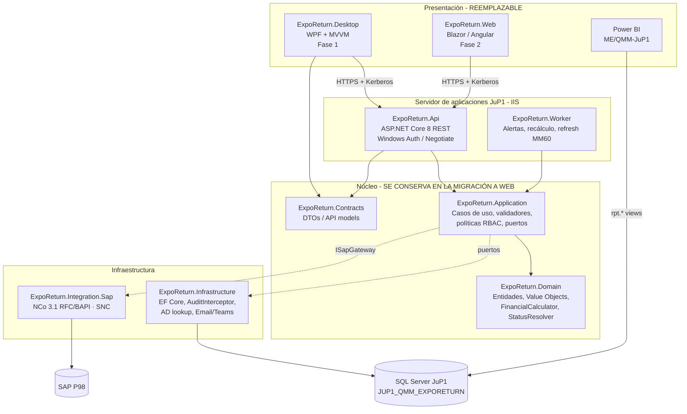
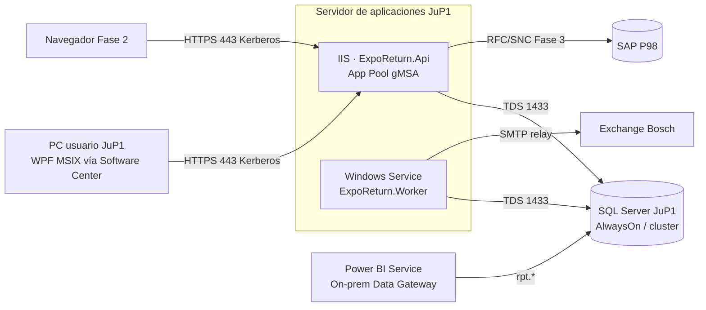

# 01 · Arquitectura de la Solución (Desktop → Web)

> **Sistema:** JuP1 Expo & Return FG Follow Up (nombre de trabajo: **ExpoReturn**)
> **Stack:** C# / .NET 8 LTS · WPF (MVVM) · ASP.NET Core 8 Web API · EF Core 8 · SQL Server 2019+
> **Principio rector:** la interfaz es **reemplazable**. Las reglas de negocio, los cálculos, la seguridad y los datos no dependen de la UI.

---

## 1. Decisiones de arquitectura (ADR resumidos)

| ID | Decisión | Alternativa descartada | Justificación |
|---|---|---|---|
| ADR-01 | **API-first desde la Fase 1**: el cliente WPF sólo habla con una Web API REST interna, nunca con SQL Server. | WPF con EF Core directo a la BD | (a) Pasar a Web es sólo cambiar el cliente; (b) no se distribuyen cadenas de conexión en las PCs de piso; (c) la autorización por campo se aplica en un solo lugar; (d) el Worker de alertas y los conectores SAP viven del lado del servidor. |
| ADR-02 | **Clean Architecture** (Domain → Application → Infrastructure / Presentation), con las dependencias apuntando hacia el dominio. | N-capas clásico con lógica en los *code-behind* | El motor de cálculo (Etapa 5) y las validaciones se prueban sin BD ni UI y se reutilizan tal cual en la Web. |
| ADR-03 | **Comandos por etapa** (`CaptureRequestCommand`, `RegisterCustomsImportCommand`, `RecordReworkCommand`, `ConfirmHseScrapCommand`, …) en vez de un `UpdatePallet` genérico. | Un PUT con el registro completo | Cada comando se mapea a un bloque del Excel y a un rol; el RBAC por campo queda explícito y auditable. |
| ADR-04 | **Estatus derivado** (máquina de estados calculada a partir de los datos) más **guardas de edición** por etapa. | Estatus capturado a mano | Elimina contradicciones como H-14 y permite recalcular el histórico migrado. |
| ADR-05 | **Concurrencia optimista** con `ROWVERSION`; un conflicto devuelve HTTP 409 y la UI ofrece *recargar y comparar*. | Bloqueo pesimista / archivo compartido | Resuelve la edición simultánea de Champions y Proxies sin bloquear a nadie. |
| ADR-06 | **Auditoría doble**: `aud.Audit_Logs` a nivel campo (escrita por un interceptor de EF Core con el NT User real) más una **tabla temporal** de SQL Server como respaldo a prueba de manipulación. | Sólo triggers | En la Fase Web la conexión a BD usa una cuenta de servicio; sólo la aplicación conoce al usuario final. |
| ADR-07 | **Integración SAP desacoplada** (`ISapGateway`) con SAP .NET Connector (NCo) 3.1 sobre RFC/BAPI + SNC/SSO. | SAP GUI Scripting | Lo pide la política Bosch: respeta las autorizaciones SAP de cada usuario, se puede probar con un *fake* y es intercambiable por OData/APIs de S/4HANA. |
| ADR-08 | **Power BI consume sólo vistas `rpt.*`** con un rol de solo lectura. | Power BI sobre tablas o sobre el Excel | Contrato estable: el modelo físico puede evolucionar sin romper los reportes. |

## 2. Vista de capas



**Regla de dependencias:** `Domain` no referencia nada; `Application` sólo referencia `Domain`; `Infrastructure`, `Integration.Sap` y `Api` implementan los puertos (interfaces) que define `Application`. **Ningún proyecto de UI referencia `Infrastructure`.**

## 3. Estructura de la solución

```
Bosch.JuP1.ExpoReturn.sln
│
├── src/
│   ├── ExpoReturn.Domain/                  ← sin dependencias externas
│   │   ├── Entities/PalletReturn.cs        (agregado raíz; métodos por etapa)
│   │   ├── ValueObjects/MaterialNumber.cs  (formato XXXX.XXX.XXX-XX(X), normaliza '0203306644-250')
│   │   ├── ValueObjects/HandlingUnit.cs    (10 dígitos)
│   │   ├── ValueObjects/Batch.cs, Money.cs, FolioCode.cs
│   │   ├── Enums/WorkflowStatus.cs, Stage.cs
│   │   ├── Rules/FinancialCalculator.cs    (CalcVersion 1 = réplica Excel, 2 = corregido)
│   │   ├── Rules/StatusResolver.cs         (máquina de estados derivada)
│   │   ├── Rules/StageGuards.cs            (qué se puede capturar en cada etapa)
│   │   └── Errors/DomainError.cs           (códigos VAL-xxx)
│   │
│   ├── ExpoReturn.Application/
│   │   ├── Abstractions/ IPalletReturnRepository, ICatalogReadService, ICurrentUser,
│   │   │                 IClock, IParameterProvider, ISapGateway, INotificationService
│   │   ├── PalletReturns/Commands/ CaptureRequest, RegisterCustomsImport, RecordLogisticsInbound,
│   │   │                           RecordRework, RecordLowExport, RegisterCustomsExport,
│   │   │                           ConfirmHseScrap, ClassifyDiscrepancy, Cancel, AdminReopen
│   │   ├── PalletReturns/Queries/  GetById, Search (paginado), GetDashboard, GetAuditTrail
│   │   ├── Security/FieldAuthorizationService.cs   (sec.Field_Permissions + Champions_Matrix)
│   │   ├── Validation/*Validator.cs                (FluentValidation)
│   │   └── Alerts/AlertEvaluator.cs
│   │
│   ├── ExpoReturn.Contracts/               ← DTOs compartidos por API, Desktop y Web
│   │
│   ├── ExpoReturn.Infrastructure/
│   │   ├── Persistence/ExpoReturnDbContext.cs, Configurations/*, Migrations/
│   │   ├── Persistence/AuditSaveChangesInterceptor.cs
│   │   ├── Identity/ActiveDirectoryUserDirectory.cs (System.DirectoryServices.AccountManagement)
│   │   └── Notifications/SmtpNotificationService.cs, TeamsWebhookNotifier.cs
│   │
│   ├── ExpoReturn.Integration.Sap/         ← adaptador NCo (puede correr como servicio .NET Framework 4.8 si hace falta)
│   │   ├── NcoSapGateway.cs  (BAPI_MATERIAL_GET_DETAIL / costos, HU, órdenes PPI*, QM notif.)
│   │   └── FakeSapGateway.cs (DEV/QAS)
│   │
│   ├── ExpoReturn.Api/                     ← ASP.NET Core 8, IIS in-process, Windows Auth
│   │   ├── Endpoints/ PalletReturnsEndpoints.cs, CatalogsEndpoints.cs, AdminEndpoints.cs
│   │   ├── Auth/ ChampionsClaimsTransformation.cs, FieldPermissionRequirement.cs
│   │   └── ProblemDetails, HealthChecks, OpenAPI (Swagger sólo DEV/QAS)
│   │
│   ├── ExpoReturn.Worker/                  ← BackgroundService / Windows Service
│   │   └── Jobs/ DailyAgingAlertsJob, Mm60CostRefreshJob, RecalculateOpenRecordsJob
│   │
│   ├── ExpoReturn.Desktop/                 ← WPF, CommunityToolkit.Mvvm
│   │   ├── Views/ PalletListView, PalletDetailView (pestañas = 6 bloques), DashboardView, AuditView
│   │   ├── ViewModels/ … (sin lógica de negocio: delegan en la API)
│   │   └── Services/ExpoReturnApiClient.cs (HttpClient, UseDefaultCredentials = true)
│   │
│   └── ExpoReturn.Migration/               ← consola ETL Excel 2.0 → stg.* (ClosedXML)
│
└── tests/
    ├── ExpoReturn.Domain.Tests/            (casos golden del Excel, propiedades de conservación)
    ├── ExpoReturn.Application.Tests/       (RBAC por campo, guardas de etapa)
    ├── ExpoReturn.Api.IntegrationTests/    (WebApplicationFactory + SQL Server de pruebas)
    └── ExpoReturn.Migration.Tests/         (parsers de fechas/HU/PN con los valores reales del Excel)
```

## 4. Responsabilidades por capa

### 4.1 Domain: dónde viven las reglas

El agregado `PalletReturn` expone **un método por bloque del Excel**. Cada método valida sus precondiciones, modifica sólo sus campos y, al final, recalcula indicadores y estatus. Nadie puede asignar los campos a mano desde fuera (setters privados).

```csharp
public sealed class PalletReturn
{
    public int Id { get; private set; }
    public ValueStreamId ValueStream { get; private set; }
    public int FolioNumber { get; private set; }
    public MaterialNumber ReturnedMaterial { get; private set; }
    public int QtyImported { get; private set; }
    public decimal? UnitCostUsd { get; private set; }
    // … resto de campos por etapa (ver 02_Modelo_Entidad_Relacion.md)

    public WorkflowStatus Status { get; private set; }
    public ReconciliationResult Financials { get; private set; } = ReconciliationResult.Zero;

    // Etapa 4 · HSE
    public Result ConfirmHseScrap(string grNumber, decimal kg, DateOnly confirmationDate, IClock clock, ICalcParameters p)
    {
        if (ScrapQty is null or <= 0)      return DomainError.Val("VAL-041", "No hay cantidad de scrap que confirmar.");
        if (ScrapDate is null)             return DomainError.Val("VAL-042", "Falta Scrap Date.");
        if (confirmationDate < ScrapDate)  return DomainError.Val("VAL-043", "La confirmación HSE no puede ser anterior al scrap.");
        if (confirmationDate > clock.Today)return DomainError.Val("VAL-003", "No se permiten fechas futuras.");
        if (!GrNumber.TryParse(grNumber, out var gr)) return DomainError.Val("VAL-044", "GR Number inválido.");
        if (kg <= 0)                       return DomainError.Val("VAL-045", "El peso destruido debe ser > 0 kg.");

        ScrapGrNumber = gr; HseScrapKg = kg; HseConfirmationDate = confirmationDate;
        return Recalculate(clock, p);
    }

    internal Result Recalculate(IClock clock, ICalcParameters p)
    {
        Financials = FinancialCalculator.For(p.CalcVersion).Calculate(this, p);
        Status     = StatusResolver.Resolve(this, Financials, clock.Today, p);
        return Result.Ok();
    }
}
```

### 4.2 Application: orquesta, autoriza y persiste

```csharp
public sealed record ConfirmHseScrapCommand(int PalletReturnId, byte[] RowVersion,
                                            string GrNumber, decimal Kg, DateOnly ConfirmationDate);

internal sealed class ConfirmHseScrapHandler(
    IPalletReturnRepository repo, IFieldAuthorizationService auth,
    ICurrentUser user, IClock clock, ICalcParameterProvider prm)
{
    public async Task<Result<PalletReturnDto>> Handle(ConfirmHseScrapCommand cmd, CancellationToken ct)
    {
        var pallet = await repo.GetAsync(cmd.PalletReturnId, ct);
        await auth.EnsureCanEditAsync(user, pallet.ValueStream,
              Fields.ScrapGrNumber, Fields.HseScrapKg, Fields.HseConfirmationDate);   // 403 si no

        var result = pallet.ConfirmHseScrap(cmd.GrNumber, cmd.Kg, cmd.ConfirmationDate, clock, await prm.GetAsync(ct));
        if (result.IsFailure) return result.Error;                                     // 422 + VAL-xxx

        await repo.SaveAsync(pallet, cmd.RowVersion, ct);                              // 409 si cambió
        return PalletReturnDto.From(pallet);
    }
}
```

### 4.3 API: contrato estable, el mismo para Desktop y Web

| Método | Ruta | Etapa | Rol mínimo |
|---|---|---|---|
| `POST` | `/api/v1/pallet-returns` | 1 · Apertura (asigna folio) | QMM, REQUESTOR |
| `PUT` | `/api/v1/pallet-returns/{id}/request` | 1 | QMM, REQUESTOR |
| `PUT` | `/api/v1/pallet-returns/{id}/customs-import` | 2 | GS |
| `PUT` | `/api/v1/pallet-returns/{id}/logistics-inbound` | 2 | QMM (PO), LOP (Delivery) |
| `PUT` | `/api/v1/pallet-returns/{id}/rework` | 3 | MFO |
| `PUT` | `/api/v1/pallet-returns/{id}/low-export` | 4 | LOW |
| `PUT` | `/api/v1/pallet-returns/{id}/customs-export` | 4 | GS |
| `PUT` | `/api/v1/pallet-returns/{id}/scrap-gr` | 4 | MFO |
| `PUT` | `/api/v1/pallet-returns/{id}/hse-confirmation` | 4 | HSE |
| `PUT` | `/api/v1/pallet-returns/{id}/classification` | 5 | QMM |
| `POST` | `/api/v1/pallet-returns/{id}/cancel` · `/reopen` | — | ADMIN_QMM_PE (motivo obligatorio) |
| `GET` | `/api/v1/pallet-returns?vs=&status=&from=&to=&page=` | consulta | todos |
| `GET` | `/api/v1/pallet-returns/{id}/audit` | consulta | todos |
| `GET` | `/api/v1/pallet-returns/{id}/permissions` | UI | todos (indica qué campos puede editar el usuario) |
| `GET` | `/api/v1/dashboard/balance?vs=&period=` | 5 | todos |
| `GET` | `/api/v1/catalogs/{name}` | catálogos | todos |

Convenciones: el `ETag` lleva el `RowVersion`, que se envía en `If-Match`. Los errores van en formato `ProblemDetails` con `code = VAL-xxx`. La API se versiona en la ruta (`/v1`).

### 4.4 Presentación WPF (Fase 1)

* MVVM con `CommunityToolkit.Mvvm`. Los ViewModels **sólo** llaman a `IExpoReturnApiClient`.
* La pantalla de detalle tiene **6 pestañas** (Solicitud, Aduana entrada, Ejecución MFO/LOW, Cierre salida/HSE, Balance, Auditoría). Al abrir un registro se llama a `GET /permissions` y los controles que el usuario no puede editar quedan en solo lectura. Es comodidad visual: la API valida de todos modos.
* La vista de lista imita el Excel (rejilla filtrable por VS, estatus y aging), con colores por estatus y semáforo IMMEX (verde, ámbar, rojo).
* Exporta a Excel **de solo lectura** (ClosedXML) para quien lo necesite, sin volver a abrir el canal de captura.

### 4.5 Qué cambia y qué no al pasar a Web (Fase 2)

| Componente | Desktop (Fase 1) | Web (Fase 2) | ¿Se reescribe? |
|---|---|---|---|
| Domain, Application, Contracts | ✔ | ✔ (mismos binarios) | **No** |
| Infrastructure, Integration.Sap, Worker | ✔ | ✔ | **No** |
| Api | ✔ | ✔ (se añaden CORS y antiforgery, si aplica) | **No** |
| Base de datos y vistas Power BI | ✔ | ✔ | **No** |
| UI | WPF | Blazor Server (o Angular/React sobre IIS / Bosch Cloud) | **Sí, sólo esta capa** |
| Autenticación | Kerberos desde la PC (`UseDefaultCredentials`) | Kerberos/Negotiate desde el navegador (o Entra ID si se publica fuera de la intranet) | Configuración |

Recomendación para la Fase 2: **Blazor Server**. Mismo lenguaje que el equipo, reutiliza `Contracts`, se hospeda en el mismo IIS y no necesita *build* de JavaScript. Si el estándar corporativo pide SPA, la API ya está lista para Angular o React.

## 5. Seguridad, roles y auditoría

### 5.1 Autenticación
* **Windows Integrated Authentication** (Negotiate/Kerberos) en IIS contra el Active Directory de Bosch. La identidad es el NT User ID (`DOMINIO\usuario`).
* Requiere un SPN `HTTP/<servidor>` para la cuenta del App Pool (lo da de alta IT/Infra).

### 5.2 Autorización: dos dimensiones
1. **Bloque (qué columnas):** `sec.Field_Permissions` (rol × campo × etapa). Replica los encabezados de área del Excel (QMM, GS/OSD43, LOP, MFO, LOW, HSE).
2. **Alcance (qué Value Stream):** `sec.Champions_Matrix` (usuario × rol × VS × Champion/Proxy, con vigencia). Se carga desde la matriz Champions_VS que mantiene Ezequiel Loya Morales.

Un `IClaimsTransformation` agrega al usuario los *claims* `role:VS7:MFO`, etc., en cada request (con caché de 5 min). El rol **ADMIN_QMM_PE** edita todo, pero debe capturar un **motivo**, que queda en `Audit_Logs.ChangeReason`.

### 5.3 Auditoría
* `AuditSaveChangesInterceptor` compara `OriginalValues` contra `CurrentValues` de cada propiedad modificada y escribe un renglón por campo en `aud.Audit_Logs` (NTUser, UTC, valor anterior y nuevo, `CorrelationId` por guardado, aplicación y máquina cliente).
* `aud.Audit_Logs` es **append-only**: `DENY UPDATE/DELETE` y un trigger `INSTEAD OF` lo garantizan.
* `trk.Pallets_Return_Tracking` es una **tabla temporal** (`SYSTEM_VERSIONING`), así que cualquier cambio, aunque se haga directo en SQL, queda en `_History`.
* Los registros no se borran: se **cancelan** con motivo (`DENY DELETE` al rol de la API).

## 6. Integración futura con SAP P98

```csharp
public interface ISapGateway
{
    Task<MaterialCost?>        GetMaterialCostAsync(MaterialNumber pn, string plant = "8640", CancellationToken ct = default);
    Task<HandlingUnitInfo?>    GetHandlingUnitAsync(HandlingUnit hu, CancellationToken ct = default);
    Task<RepairOrderInfo?>     GetRepairOrderAsync(string orderNo, CancellationToken ct = default);   // PPI2..PPI6
    Task<QualityNotification?> GetQualityNotificationAsync(string qmNo, CancellationToken ct = default);
}
```

* **Fase 1:** `FakeSapGateway` más carga de MM60 por archivo (`stg.usp_LoadMM60`). El sistema funciona sin SAP.
* **Fase 3:** `NcoSapGateway` con SAP .NET Connector 3.1, RFC/BAPI sobre **SNC con SSO**, así que cada consulta se ejecuta con las autorizaciones SAP del usuario.
  * *[VALIDAR con SAP Basis]* Que la versión de NCo autorizada en Bosch soporte .NET 8. Si no, el adaptador se hospeda como un microservicio **.NET Framework 4.8** detrás de la misma interfaz, sin tocar el resto.
  * Sólo lectura (validar costo MM60, existencia de HU, estatus de la orden PPI). **No se escribe en SAP** desde esta aplicación.
* **Ruta S/4HANA / BBM Datalayer:** la interfaz no conoce RFC. Cuando DALI desaparezca y P98 migre a S/4HANA, se agrega otra implementación (OData/APIs liberadas o los *data products* de BBM Datalayer) **sin cambiar** Application ni la UI.

## 7. Gobernanza corporativa

| Tema | Acción |
|---|---|
| **SOURCE** | Registrar la aplicación antes del piloto: dueño de negocio (ME/QMM-JuP1, Process Excellence), dueño técnico, clasificación de información (datos financieros y aduanales, **confidencial interno**), interfaces (SAP P98, Power BI, AD, SMTP) y ciclo de vida. |
| **BBM Datalayer** | Las vistas `rpt.*` son el *data product* candidato. Se documentan su esquema, la frecuencia de actualización y el dueño para que BBM las pueda ingerir. No se usan extracciones DALI nuevas. |
| **Seguridad de la información** | Mínimo privilegio en BD (`role_exporeturn_api`, `role_exporeturn_bi`), TLS en IIS, sin secretos en el cliente y sin cadenas de conexión en las PCs. |
| **Respaldo** | Respaldo FULL diario + LOG cada 15 min (RPO ≤ 15 min, RTO ≤ 4 h) según el estándar del servidor SQL de JuP1. |

## 8. Requerimientos no funcionales

| Atributo | Meta |
|---|---|
| Usuarios concurrentes | ≥ 60 (Champions y Proxies de 7 áreas × 5 VS) sin degradación |
| Tiempo de respuesta | Lista paginada < 1 s · guardado < 500 ms (p95) |
| Disponibilidad | Horario de 3 turnos, 24×6 · ventana de mantenimiento el domingo |
| Volumen | ~600 registros/año/VS (estimado según los rangos del Excel). El diseño soporta > 100k sin cambios. |
| Trazabilidad | 100 % de los cambios auditados a nivel campo y retención ≥ 5 años (alineado al plazo de conservación aduanal) *[VALIDAR GS]* |
| Observabilidad | Serilog → archivo + visor central · `/health` para monitoreo · correlación por `CorrelationId` |
| Idioma | UI bilingüe ES/EN (recursos `.resx`) · nombres técnicos en inglés |

## 9. Despliegue (vista física)



Ambientes: **DEV → QAS → PRD**, cada uno con su propia BD. CI/CD en el repositorio corporativo (Azure DevOps o GitHub Enterprise de Bosch): *build*, pruebas, migraciones EF como script idempotente revisado por el DBA y despliegue con aprobación.
