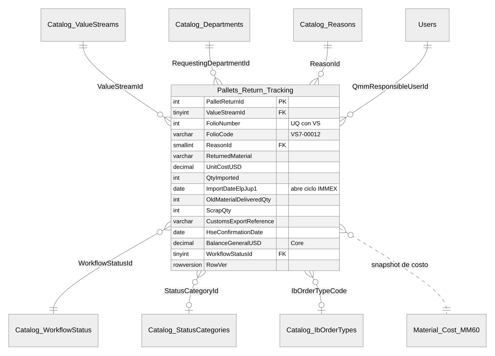
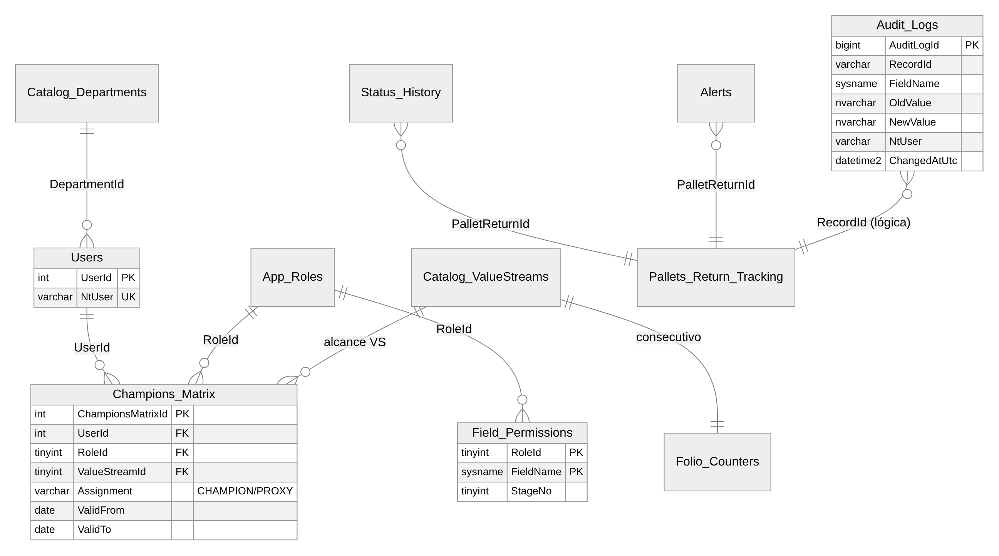

<!-- GENERADO desde entregables/SRS_ExpoReturn_FG_JuP1_v0.2.docx el 2026-11-06 con tools/docx/docx_to_md.py. La fuente de verdad es el Word: haga los cambios en el .docx y vuelva a generar. -->

# 02 · Modelo Entidad-Relación (SQL Server)

> DDL ejecutable: `database/01_schema.sql` · Semillas: `02_seed_catalogs.sql` · Vistas Power BI: `03_views_powerbi.sql` · Staging de migración: `04_staging_migration.sql`

## 1. Esquemas

| **Esquema** | **Contenido**                                                                                  | **Quién escribe**      |
|-------------|------------------------------------------------------------------------------------------------|------------------------|
| `cat`       | Catálogos: Value Streams, departamentos, motivos, estatus, categorías, órdenes IB, costos MM60 | Admin QMM/PE, job MM60 |
| `sec`       | Usuarios, roles, **Champions_Matrix**, permisos por campo                                      | Admin QMM/PE           |
| `trk`       | **Pallets_Return_Tracking** (+ `_History` temporal), folios, historial de estatus, alertas     | API, Worker            |
| `aud`       | **Audit_Logs** (append-only)                                                                   | API (interceptor)      |
| `cfg`       | Parámetros versionados (tasa de duty, plazos, SLA), periodos fiscales, ventanas de reporte     | Admin QMM/PE + GS      |
| `rpt`       | Vistas para Power BI                                                                           | sólo lectura           |
| `stg`       | Staging y bitácora de migración                                                                | Migration console      |

## 2. Diagrama entidad-relación

### 2.1 Núcleo transaccional y catálogos

### 2.2 Seguridad, auditoría y soporte

**¿Por qué una sola tabla transaccional con columnas por etapa y no tablas hijas por movimiento?** Porque cada pallet tiene, en la práctica, **una** importación, **un** cierre MFO, **una** exportación y **una** confirmación HSE (relación 1:1). Una tabla ancha y bien tipada hace la migración 1:1 desde el Excel, simplifica Power BI y permite reglas `CHECK` entre etapas. Si en el futuro aparecen exportaciones parciales múltiples por pallet, se agrega `trk.Pallet_Movements` (tipo EXPORT/SCRAP/NATIONAL, cantidad, documento) y los campos actuales pasan a ser totales derivados. Es un cambio aditivo.

## 3. Tablas solicitadas: definición

### 3.1 `cat.Catalog_ValueStreams`

| **Columna**                       | **Tipo**      | **Nulo** | **Regla**                               |
|-----------------------------------|---------------|----------|-----------------------------------------|
| ValueStreamId                     | TINYINT       | PK       | **Es el número del VS** (1, 4, 5, 7, 9) |
| Code                              | VARCHAR(5)    | no       | UQ · `CHECK Code = 'VS' + Id`           |
| Name                              | NVARCHAR(100) | no       |                                         |
| LegacySheetName / LegacyTableName | VARCHAR(31)   | sí       | Trazabilidad con `VS7` / `VS_7`         |
| IsActive, SortOrder               | BIT, TINYINT  | no       |                                         |

### 3.2 `cat.Catalog_Reasons`

| **Columna**         | **Tipo**         | **Regla**                                                                                      |
|---------------------|------------------|------------------------------------------------------------------------------------------------|
| ReasonId            | SMALLINT PK      | 1..10                                                                                          |
| Code                | VARCHAR(10) UQ   | R01..R10                                                                                       |
| Description         | NVARCHAR(150) UQ | Texto oficial en inglés (idéntico al Excel)                                                    |
| ReasonGroup         | VARCHAR(20)      | PACKAGING · REFLASH · INSPECTION · COMPLETION                                                  |
| RequiresNewMaterial | BIT              | `1` para *To change FG P/N with reflash*: obliga a capturar `NewMaterial` distinto al original |

> El Excel tiene **10** motivos (la especificación dice 9). Se cargaron los 10; QMM debe confirmar si *Inspect due to mistakes in standard pack* sigue vigente.

### 3.3 `cat.Catalog_Departments`

| **Columna**        | **Tipo**             | **Regla**                                                          |
|--------------------|----------------------|--------------------------------------------------------------------|
| DepartmentId       | SMALLINT IDENTITY PK |                                                                    |
| Code               | VARCHAR(20) UQ       | `QMM`, `QMM-C1`, `MFQ5`, `LOP2`, `GS/OSD43`, `HSE`, `PUQ` …        |
| FunctionalArea     | VARCHAR(10)          | QMM · MFO · MFQ · LOP · LOW · GS · HSE · PUQ · OTHER               |
| ParentDepartmentId | SMALLINT FK (self)   | `MFQ5 → MFQ` (permite agrupar en Power BI)                         |
| CanRequest         | BIT                  | Sólo los departamentos con `1` aparecen en "Requesting department" |

### 3.4 `sec.Champions_Matrix`

| **Columna**         | **Tipo**                     | **Regla**                                                    |
|---------------------|------------------------------|--------------------------------------------------------------|
| ChampionsMatrixId   | INT IDENTITY PK              |                                                              |
| UserId              | INT FK → `sec.Users`         | `sec.Users.NtUser` = DOMINIO\usuario (AD)                    |
| RoleId              | TINYINT FK → `sec.App_Roles` | QMM, GS, LOP, MFO, LOW, HSE, REQUESTOR, ADMIN_QMM_PE, VIEWER |
| ValueStreamId       | TINYINT FK, **nulo = todos** |                                                              |
| DepartmentId        | SMALLINT FK                  | Departamento con el que actúa                                |
| Assignment          | VARCHAR(10)                  | CHAMPION · PROXY · ADMIN · VIEWER                            |
| ValidFrom / ValidTo | DATE                         | Vigencia: un cambio de Champion no borra la historia         |

Uso: "¿Puede el usuario X editar `ScrapQty` del folio VS7-00012?" ⇔ existe un renglón vigente de X con un rol que tenga `ScrapQty` en `sec.Field_Permissions` y `ValueStreamId IN (7, NULL)`, o X tiene un rol con `IsAdmin = 1`.

### 3.5 `aud.Audit_Logs`

| **Columna**                            | **Tipo**                            | **Regla**                                                  |
|----------------------------------------|-------------------------------------|------------------------------------------------------------|
| AuditLogId                             | BIGINT IDENTITY PK                  |                                                            |
| TableName / RecordId / FolioCode       | SYSNAME / VARCHAR(50) / VARCHAR(20) |                                                            |
| Action                                 | CHAR(1)                             | I · U · D                                                  |
| FieldName                              | SYSNAME                             | Un renglón por campo modificado                            |
| OldValue / NewValue                    | NVARCHAR(4000)                      | Formato invariante (ISO 8601 para fechas, `.` decimal)     |
| NtUser                                 | VARCHAR(64)                         | Usuario real (no la cuenta de servicio)                    |
| ClientApp / ClientMachine / AppVersion | VARCHAR                             | DESKTOP · WEB · WORKER · MIGRATION                         |
| CorrelationId                          | UNIQUEIDENTIFIER                    | Agrupa los campos de un mismo guardado                     |
| ChangeReason                           | NVARCHAR(500)                       | Obligatorio en override de admin, reapertura o cancelación |
| ChangedAtUtc                           | DATETIME2(3)                        |                                                            |

Inmutabilidad: trigger `INSTEAD OF UPDATE, DELETE` + `DENY UPDATE, DELETE`.

### 3.6 `trk.Pallets_Return_Tracking`: diccionario de datos y mapeo con el Excel

Cada fila del Excel (en cualquiera de las 5 hojas) se convierte en un renglón; la hoja se vuelve `ValueStreamId`.

| **\#** | **Encabezado Excel (variantes)**         | **Columna SQL**                                                                                                          | **Tipo**                       | **Etapa / Dueño** | **Regla principal**                                                                               |
|--------|------------------------------------------|--------------------------------------------------------------------------------------------------------------------------|--------------------------------|-------------------|---------------------------------------------------------------------------------------------------|
| B      | `#`                                      | `FolioNumber` (+ `FolioCode` calc.)                                                                                      | INT                            | 1 · Sistema       | Consecutivo por VS (`trk.usp_NextFolio`), no editable                                             |
| C      | QMM Responsible                          | `QmmResponsibleUserId`                                                                                                   | INT FK                         | 1 · QMM           | Selector de Champions/Proxies del VS                                                              |
| D      | Requesting department                    | `RequestingDepartmentId`                                                                                                 | SMALLINT FK                    | 1 · Solicitante   | Catálogo, obligatorio                                                                             |
| E      | Requestor                                | `RequestorName`                                                                                                          | NVARCHAR(150)                  | 1 · Solicitante   | Texto libre "Apellido, Nombre"; ya no lleva el departamento                                       |
| F      | Reason                                   | `ReasonId`                                                                                                               | SMALLINT FK                    | 1 · Solicitante   | Selector estricto, obligatorio                                                                    |
| G      | "Return Reason" 22.09.26                 | `ReturnReasonDetail`                                                                                                     | NVARCHAR(500)                  | 1 · Solicitante   | Detalle libre                                                                                     |
| H      | Returned Pallet 13 Digits Part number    | `ReturnedMaterial`                                                                                                       | VARCHAR(18)                    | 1 · QMM           | `XXXX.XXX.XXX-XX(X)`; normaliza la captura sin puntos                                             |
| I      | MM60 SAP UNIT COST                       | `UnitCostUSD`, `UnitCostSource`, `UnitCostCapturedAtUtc`                                                                 | DECIMAL(18,6)                  | 1 · Sistema       | Snapshot de `Material_Cost_MM60` (Price/PriceUnit). Sin costo → `PENDING` (sustituye a "COSTEAR") |
| J      | SAP USD TOTAL                            | `SapUsdTotal`                                                                                                            | DECIMAL(18,2) calc. persistida | 1 · Sistema       | `QtyImported × UnitCostUSD`                                                                       |
| K      | Quantity / Quantity imported             | `QtyImported`                                                                                                            | INT                            | 1 · QMM           | \> 0                                                                                              |
| L      | Original \#HU                            | `OriginalHU`                                                                                                             | VARCHAR(20)                    | 1 · QMM           | 10 dígitos numéricos                                                                              |
| M      | Original Batch                           | `OriginalBatch`                                                                                                          | VARCHAR(10)                    | 1 · QMM           | SAP CHARG                                                                                         |
| N      | Date PO / Date Returned to WHS           | `DateReturnedToWhs`                                                                                                      | DATE                           | 2 · GS/QMM        | ≤ fechas posteriores                                                                              |
| O      | Import Date                              | `ImportDate`                                                                                                             | DATE                           | 2 · GS            | ≥ DateReturnedToWhs                                                                               |
| P      | Invoice                                  | `ImportInvoice`                                                                                                          | VARCHAR(20)                    | 2 · GS            | `MPSyy######`                                                                                     |
| Q      | Import date ELP-JuP1                     | `ImportDateElpJup1`                                                                                                      | DATE                           | 2 · GS            | **Abre el ciclo IMMEX** (aging, plazo legal)                                                      |
| —      | *(nuevo)*                                | `ImportPedimento`                                                                                                        | VARCHAR(25)                    | 2 · GS            | Opcional                                                                                          |
| R      | PO Number / Return PO                    | `ReturnPONumber`, `ReturnPOItem`                                                                                         | VARCHAR(10)/(6)                | 2 · QMM           | `49398082 - 999` → PO + posición                                                                  |
| S      | Delivery Number 22.09.26                 | `DeliveryNumber`                                                                                                         | VARCHAR(10)                    | 2 · LOP           |                                                                                                   |
| —      | *(nuevo)*                                | `DutyPaymentStatus`                                                                                                      | VARCHAR(12)                    | 2 · GS/LOP        | NOT_REQUIRED · PENDING · PAID                                                                     |
| —      | *(nuevo)*                                | `IbOrderNumber`, `IbOrderTypeCode`                                                                                       | VARCHAR(12), CHAR(4) FK        | 3 · MFO           | Orden PPI2..PPI6                                                                                  |
| U      | Physical material delivered to LOW       | `PhysicalDeliveredQty` (+ `PhysicalDeliveredDate`)                                                                       | INT, DATE                      | 3 · MFO           | = Old + Reinsertion. **Cierra el retrabajo MFO**                                                  |
| T      | Returned Pallet 13 Dgt New PN            | `NewMaterial`                                                                                                            | VARCHAR(18)                    | 3 · MFO           | Obligatorio y distinto si el motivo es reflash                                                    |
| V      | New HU                                   | `NewHU`                                                                                                                  | VARCHAR(20)                    | 3 · MFO           | 10 dígitos                                                                                        |
| W      | Original Batch (rework)                  | `ReworkBatch`                                                                                                            | VARCHAR(10)                    | 3 · MFO           |                                                                                                   |
| X      | New Reinsertion Material Qty             | `ReinsertionQty`                                                                                                         | INT                            | 3 · MFO           | Material nuevo agregado (no es importación temporal)                                              |
| Y      | Date send Back                           | `DateSentBack`                                                                                                           | DATE                           | 3 · MFO           | ≥ ImportDateElpJup1                                                                               |
| Z      | Old Material Delivered to LOW            | `OldMaterialDeliveredQty`                                                                                                | INT                            | 3 · MFO           | Old + Scrap ≤ QtyImported                                                                         |
| AA     | Scrap to HSE (Qty)                       | `ScrapQty`                                                                                                               | INT                            | 3 · MFO           | \> 0 exige ScrapDate                                                                              |
| AB     | Scrap Date                               | `ScrapDate`                                                                                                              | DATE                           | 3 · MFO           |                                                                                                   |
| AC     | LOW export                               | `LowExportNumber`, `LowExportDate`, `LowExportNote`                                                                      | SMALLINT, DATE, NVARCHAR       | 4 · LOW           | Separa "expo \#4 del día 17/07/2026" en campos                                                    |
| AD     | Customs Export                           | `CustomsExportReference` (+ `CustomsExportDate`, `ExportPedimento`)                                                      | VARCHAR(30)                    | 4 · GS            | `PRyy-#####`; ya **no** lleva fórmula (H-02)                                                      |
| AE     | GR Number                                | `ScrapGrNumber`                                                                                                          | VARCHAR(10)                    | 4 · MFO           |                                                                                                   |
| AF     | Qty (Kg) from HSE / Kg Qty from HSE      | `HseScrapKg`                                                                                                             | DECIMAL(10,3)                  | 4 · HSE           | \> 0                                                                                              |
| AG     | HSE confirmation Date                    | `HseConfirmationDate`                                                                                                    | DATE                           | 4 · HSE           | ≥ ScrapDate; bloque GR+Kg+Fecha todo o nada                                                       |
| —      | *(nuevo: cono verde / plataforma / RMA)* | `GreenConeReported`, `PlatformReported`, `RmaNumber`                                                                     | BIT, BIT, VARCHAR(20)          | 3 · MFO/LOW       | Evidencia para las categorías "NO REPORTADO…"                                                     |
| AH     | Balance GENERAL DLLS                     | `BalanceGeneralUSD`                                                                                                      | DECIMAL(18,2)                  | 5 · Core          | Ver 03 §3                                                                                         |
| AI     | MFO INVENTORY USD                        | `MfoInventoryUSD`                                                                                                        | DECIMAL(18,2)                  | 5 · Core          |                                                                                                   |
| AJ     | HSE SCRAP USD                            | `HseScrapUSD`                                                                                                            | DECIMAL(18,2)                  | 5 · Core          |                                                                                                   |
| AK     | MFO-LOW FAILURE USD                      | `MfoLowFailureUSD`                                                                                                       | DECIMAL(18,2)                  | 5 · Core          |                                                                                                   |
| —      | *(nuevo)*                                | `DutyExposureUSD`, `QtyOpenFloor`, `QtyPendingExport`, `QtyPendingHse`, `QtyMissing`                                     |                                | 5 · Core          | Conciliación explícita                                                                            |
| AL     | COMMENTS / Date - Name: / Column2        | `StatusCategoryId` + `Comments`                                                                                          | SMALLINT FK + NVARCHAR(1000)   | 5 · QMM           | Categoría por catálogo; comentario libre aparte                                                   |
| —      | *(nuevo)*                                | `WorkflowStatusId`, `IsDutyRisk`, `DutyRiskReason`, `LegalDueDate`, `CalcVersion`                                        |                                | 5 · Core          | Máquina de estados                                                                                |
| —      | *(control)*                              | `IsCancelled`, `IsLegacy`, `LegacySourceSheet/Row`, `DataQualityFlags`, `Created*/Modified*`, `RowVer`, periodo temporal |                                | Sistema           |                                                                                                   |

### 3.7 Tablas de soporte (adicionales a las solicitadas)

| **Tabla**                                             | **Para qué**                                                                                                                                                                                                    |
|-------------------------------------------------------|-----------------------------------------------------------------------------------------------------------------------------------------------------------------------------------------------------------------|
| `cat.Catalog_WorkflowStatus`                          | 11 estatus: DRAFT, REQUESTED, IMPORTED, IN_REWORK, PENDING_HSE, PENDING_EXPORT, DUTY_RISK, EXPORTED, SCRAPPED, CLOSED_DUTY_PAID, CANCELLED                                                                      |
| `cat.Catalog_StatusCategories`                        | Unifica las 12 categorías de las listas por hoja: OUTCOME (EXPORT, SCRAP, INVENTORY, ENVÍO NACIONAL) y DISCREPANCY con área responsable (NO REPORTADO CON CONO VERDE → MFO, CONO NO REPORTADO POR LOW → LOW, …) |
| `cat.Catalog_IbOrderTypes`                            | PPI2..PPI6                                                                                                                                                                                                      |
| `cat.Material_Cost_MM60`                              | Maestro de costos **versionado** (ValidFrom/ValidTo). Reemplaza la hoja oculta                                                                                                                                  |
| `sec.Users`, `sec.App_Roles`, `sec.Field_Permissions` | RBAC                                                                                                                                                                                                            |
| `cfg.Parameters`                                      | `DUTY_RATE` (0.19), `IMMEX_LEGAL_TERM_DAYS`, umbrales de alerta, SLA, `CALC_VERSION_ACTIVE`, todos con vigencia                                                                                                 |
| `cfg.Fiscal_Periods`, `cfg.Reporting_Windows`         | Periodos fiscales para BALANCE\_ y ventanas heredadas ("AFTER JUNE 2025", "+ NOV 2025")                                                                                                                         |
| `trk.Folio_Counters`                                  | Folio por VS sin colisiones                                                                                                                                                                                     |
| `trk.Status_History`                                  | Lead time por etapa                                                                                                                                                                                             |
| `trk.Alerts`                                          | Alertas IMMEX/SLA abiertas o resueltas (una abierta por tipo y pallet)                                                                                                                                          |

## 4. Vistas para Power BI (`rpt`)

| **Vista**                           | **Grano**                                                                                                  | **Sustituye en el Excel**                                                                                                          |
|-------------------------------------|------------------------------------------------------------------------------------------------------------|------------------------------------------------------------------------------------------------------------------------------------|
| `rpt.vw_PalletReturns`              | 1 renglón por pallet, nombres de negocio, aging, días al vencimiento, periodo fiscal, tasa de duty vigente | Las 5 hojas VS                                                                                                                     |
| `rpt.vw_Balance_ByVS_Period`        | VS × periodo fiscal                                                                                        | Bloque "AFTER JUNE 2025" y hoja BALANCE\_ (Total Imported, MFO Inventory, HSE Scrap, MFO-LOW Failure, Exported, **Duties to Pay**) |
| `rpt.vw_QtyReconciliation_ByWindow` | Ventana × VS                                                                                               | Bloque "FINISH GOOD RETURN (QTY)" (Import, Exported, Physical Inventory, Missing, Not Reported Scrap)                              |
| `rpt.vw_DutyRisk_Open`              | Pallet en riesgo                                                                                           | (no existía) lista de acción diaria                                                                                                |
| `rpt.vw_AuditTrail`                 | Cambio de campo                                                                                            | (no existía)                                                                                                                       |
| `rpt.vw_StageLeadTime`              | Pallet × estatus                                                                                           | (no existía) tiempo por etapa                                                                                                      |

## 5. Índices y desempeño

- `IX_PRT_VS_Status (ValueStreamId, WorkflowStatusId)`: rejilla principal por VS.

- `IX_PRT_ImportElp (ImportDateElpJup1)`: aging y BALANCE por periodo.

- `UX_PRT_HU_Invoice` (filtrado, únicamente registros nuevos y no cancelados): evita que el mismo HU se importe dos veces con la misma factura.

- `UX_Material_Cost_MM60_Current` (filtrado `ValidTo IS NULL`): búsqueda de costo vigente en O(log n) sobre más de 33 k materiales.
