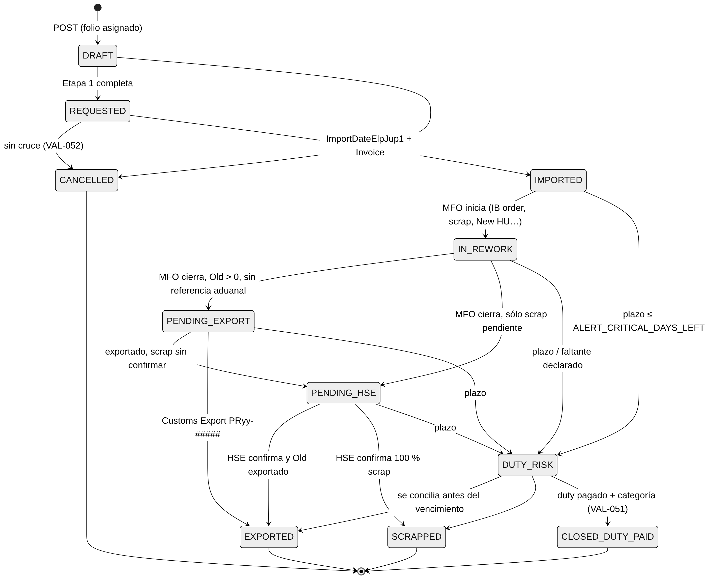

<!-- GENERADO desde entregables/SRS_ExpoReturn_FG_JuP1_v0.3.docx el 2026-11-06 con tools/docx/docx_to_md.py. La fuente de verdad es el Word: haga los cambios en el .docx y vuelva a generar. -->

# 03 · Reglas de Negocio, Validaciones y Fórmulas Automatizadas

> Todas las reglas de este documento viven en `ExpoReturn.Domain` (cálculo y estatus) y en `ExpoReturn.Application` (autorización y orquestación). La base de datos repite como `CHECK` las invariantes duras (01_schema.sql) como segunda línea de defensa.

## 1. Principios

1.  **Conservación de cantidades.** Toda pieza importada temporalmente termina en exactamente uno de estos estados: *en piso MFO*, *entregada a LOW pendiente de exportar*, *exportada con referencia aduanal*, *scrap pendiente de HSE*, *scrap confirmado por HSE* o *faltante*. La suma siempre es igual a `QtyImported`.

2.  **El ciclo IMMEX lo abre el cruce** `ImportDateElpJup1`**.** Antes de esa fecha no hay exposición financiera ni aduanal.

3.  **Un cierre necesita evidencia documental.** Lo exportado sólo cuenta con `CustomsExportReference`; el scrap sólo cuenta con `HseConfirmationDate + ScrapGrNumber + HseScrapKg`. Los textos ("Incluido en expo \#4…") y las fórmulas no cierran nada.

4.  **El estatus se calcula, no se captura.** Lo que captura el usuario son datos; el sistema deriva el estatus y los cuatro indicadores USD.

5.  **Ningún parámetro se escribe en el código.** La tasa de duty, los plazos legales, los SLA y las ventanas de reporte están en `cfg.Parameters` con vigencia.

## 2. Guardas de etapa y catálogo de validaciones

Severidad: **E** = bloquea el guardado (HTTP 422) · **W** = permite guardar, pero muestra la advertencia y deja una bandera.

### 2.1 Reglas transversales

| **Código** | **Sev.** | **Regla**                                                                                                                               |
|------------|----------|-----------------------------------------------------------------------------------------------------------------------------------------|
| VAL-001    | W        | Campos obligatorios de la etapa. Un borrador se puede guardar incompleto, pero no avanza de estatus hasta completarlos (ver 2.2–2.5)    |
| VAL-002    | E        | Las fechas se capturan con selector de fecha (no se acepta texto)                                                                       |
| VAL-003    | E        | No se permiten fechas futuras (\> hoy, hora local de Juárez)                                                                            |
| VAL-005    | E        | Un registro cerrado (EXPORTED, SCRAPPED, CLOSED_DUTY_PAID, CANCELLED) es de sólo lectura. Sólo ADMIN_QMM_PE puede reabrirlo, con motivo |
| VAL-006    | E        | Concurrencia: si el `RowVersion` no coincide → 409 y la UI ofrece recargar y comparar                                                   |
| AUTH-001   | E        | El usuario sólo edita los campos de su rol (`sec.Field_Permissions`) en los VS donde es Champion/Proxy (`sec.Champions_Matrix`) → 403   |

### 2.2 Etapa 1 · Solicitud y apertura (QMM / solicitante)

| **Código** | **Sev.** | **Regla**                                                                                                                                                     |
|------------|----------|---------------------------------------------------------------------------------------------------------------------------------------------------------------|
| VAL-010    | E        | `ReturnedMaterial` cumple `^[0-9A-Z]{4}\.[0-9A-Z]{3}\.[0-9A-Z]{3}-[0-9A-Z]{2,3}$`. La captura `0203306644-250` se normaliza sola a `0203.306.644-250`         |
| VAL-011    | W        | El material existe en `Material_Cost_MM60` con precio \> 0. Si no, `UnitCostSource = PENDING`, alerta COST_PENDING y SapUsdTotal en 0 (sustituye a "COSTEAR") |
| VAL-012    | E        | `QtyImported` entero \> 0                                                                                                                                     |
| VAL-013    | W        | `OriginalHU` de 10 dígitos numéricos. Es advertencia porque en la práctica esta columna suele traer el lote \[VALIDAR con QMM y LOW\]. Se exige HU **o** lote |
| VAL-014    | E        | `OriginalBatch` alfanumérico de ≤ 10 caracteres (p. ej. `AC20887866`); no se aceptan fechas ni espacios                                                       |
| VAL-015    | W        | `ReasonId` del catálogo (selector estricto)                                                                                                                   |
| VAL-016    | W        | `RequestingDepartmentId` de un departamento con `CanRequest = 1`                                                                                              |
| VAL-017    | W        | `QmmResponsibleUserId` es Champion/Proxy QMM vigente del VS                                                                                                   |
| VAL-018    | W        | Ya existe un registro **abierto** con el mismo `OriginalHU`                                                                                                   |

**Etapa 1 completa** = VS, QMM Responsible, Requesting department, Requestor, Reason, P/N, Qty, HU y Batch → estatus `REQUESTED`.

### 2.3 Etapa 2 · Aduanas y logística de entrada (GS/OSD43, QMM, LOP)

| **Código** | **Sev.** | **Regla**                                                                                                                                                                      |
|------------|----------|--------------------------------------------------------------------------------------------------------------------------------------------------------------------------------|
| VAL-020    | E        | Requiere la Etapa 1 completa                                                                                                                                                   |
| VAL-021    | W        | `DateReturnedToWhs ≤ ImportDate ≤ ImportDateElpJup1`. Es advertencia porque la fecha PO puede ser la de la PO de retorno, posterior a la importación \[VALIDAR con QMM y LOP\] |
| VAL-022    | E        | `ImportDateElpJup1` requiere `ImportInvoice` e `ImportDate` (y ya no se concatenan en una celda)                                                                               |
| VAL-023    | W        | `ImportInvoice` cumple `^MPS\d{8}$` y su año (`MPS``26`…) coincide con el de `ImportDate` (este cruce habría detectado el caso VS1: JAN.20.**2025** con MPS**26**000009)       |
| VAL-024    | E        | `ReturnPONumber` de 8 dígitos; la posición va en `ReturnPOItem`                                                                                                                |
| VAL-025    | W        | `DeliveryNumber` vacío y `DutyPaymentStatus` vacío después de 2 días del cruce                                                                                                 |

Al capturar `ImportDateElpJup1` → estatus `IMPORTED`, `LegalDueDate = ImportDateElpJup1 + IMMEX_LEGAL_TERM_DAYS` y arranca el aging.

### 2.4 Etapa 3 · Ejecución en planta (MFO / LOW)

| **Código** | **Sev.** | **Regla**                                                                                                                                                                                                                                             |
|------------|----------|-------------------------------------------------------------------------------------------------------------------------------------------------------------------------------------------------------------------------------------------------------|
| VAL-030    | E        | Requiere `ImportDateElpJup1` (el material está físicamente en JuP1)                                                                                                                                                                                   |
| VAL-031    | E        | Si `Reason.RequiresNewMaterial = 1` (reflash): `NewMaterial` es obligatorio y **distinto** de `ReturnedMaterial`. Si el motivo no es reflash y `NewMaterial ≠ ReturnedMaterial` → W, con sugerencia de cambiar el motivo (caso VS5)                   |
| VAL-032    | E        | `PhysicalDeliveredQty = OldMaterialDeliveredQty + ReinsertionQty`                                                                                                                                                                                     |
| VAL-033    | E        | `OldMaterialDeliveredQty + ScrapQty ≤ QtyImported` (no se puede sacar más de lo importado)                                                                                                                                                            |
| VAL-034    | E        | **Al cerrar MFO** (capturar `PhysicalDeliveredQty`): `Old + Scrap = QtyImported`. Si no cuadra, el usuario debe marcar **"Declarar faltante"** y elegir una categoría DISCREPANCY. El registro pasa a `DUTY_RISK` con `QtyMissing` visible (caso VS9) |
| VAL-035    | E        | `ScrapQty > 0` ⇒ `ScrapDate` obligatorio y ≥ `ImportDateElpJup1`                                                                                                                                                                                      |
| VAL-036    | W        | `NewHU` de 10 dígitos. Es advertencia porque existen HU nuevos de 9 dígitos \[VALIDAR con QMM y LOW\]                                                                                                                                                 |
| VAL-037    | E        | `DateSentBack ≥ ImportDateElpJup1`                                                                                                                                                                                                                    |
| VAL-038    | W        | `IbOrderNumber`/`IbOrderTypeCode` vacíos al cerrar MFO                                                                                                                                                                                                |

### 2.5 Etapa 4 · Cierre aduanal de salida y confirmación de scrap

| **Código** | **Sev.** | **Regla**                                                                                                                                                                                                                                                                              |
|------------|----------|----------------------------------------------------------------------------------------------------------------------------------------------------------------------------------------------------------------------------------------------------------------------------------------|
| VAL-040    | E        | `LowExport*` requiere `PhysicalDeliveredQty` y `Old > 0`                                                                                                                                                                                                                               |
| VAL-041    | E        | Confirmación HSE requiere `ScrapQty > 0` (caso VS9: HSE confirmó 0.5 kg con scrap en 0)                                                                                                                                                                                                |
| VAL-042    | E        | Confirmación HSE requiere `ScrapDate`                                                                                                                                                                                                                                                  |
| VAL-043    | E        | `HseConfirmationDate ≥ ScrapDate`                                                                                                                                                                                                                                                      |
| VAL-044    | E        | `ScrapGrNumber` numérico de 10 dígitos (lo captura MFO)                                                                                                                                                                                                                                |
| VAL-045    | E        | `HseScrapKg > 0` · el bloque GR + Kg + Fecha se captura completo o no se captura                                                                                                                                                                                                       |
| VAL-046    | E        | `CustomsExportReference` debe ser `PRyy-#####` (exportación), `F4` (cambio de régimen: se cierra con duty pagado) o `V1` (pedimento virtual / envío nacional) \[VALIDAR con GS/OSD43\]. Textos como "scrap marzo" o "sc1", fórmulas o cantidades **no cierran** el pallet (H-02, H-05) |
| VAL-047    | W        | La exportación aduanal tarda más de `INTERNAL_SLA_EXPORT_DAYS` desde la entrega a LOW                                                                                                                                                                                                  |

### 2.6 Etapa 5 · Clasificación y cierre con discrepancia

| **Código** | **Sev.** | **Regla**                                                                                            |
|------------|----------|------------------------------------------------------------------------------------------------------|
| VAL-050    | E        | `QtyMissing > 0` ⇒ `StatusCategoryId` de tipo DISCREPANCY obligatorio (con área responsable)         |
| VAL-051    | E        | Cerrar como `CLOSED_DUTY_PAID` requiere `DutyPaymentStatus = PAID` y una categoría DISCREPANCY       |
| VAL-052    | E        | Cancelar sólo si no hay `ImportDateElpJup1` (lo que ya cruzó la frontera no se cancela: se concilia) |

## 3. Motor de cálculo financiero (Etapa 5)

### 3.1 CalcVersion 1: réplica exacta del Excel (sólo para la migración y la corrida en paralelo)

    Cost = UnitCostUSD
    MFO_INVENTORY_USD   = ImportDateElp vacío ? 0 : (PhysicalDelivered vacío ? Qty − Old − Scrap : 0) × Cost
    HSE_SCRAP_USD       = (CustomsExport vacío ? Scrap : 0) × Cost
    MFO_LOW_FAILURE_USD = (CustomsExport vacío ? Old   : 0) × Cost
    BALANCE_GENERAL     = MFO_INVENTORY + HSE_SCRAP + MFO_LOW_FAILURE
    DUTIES_TO_PAY (BALANCE_) = Σ MFO_LOW_FAILURE × 0.19

> En v1, "vacío" se evalúa como en Excel: una celda con fórmula (aunque dé 0) **no** está vacía. El extractor guarda `CustomsExportIsFormula` para reproducir este comportamiento y conciliar contra el Excel al centavo.

### 3.2 CalcVersion 2: reglas corregidas (producción)

Banderas de evidencia:

    imported        = ImportDateElpJup1 ≠ null  ∧  ¬IsCancelled
    mfoClosed       = PhysicalDeliveredQty ≠ null
    exported        = CustomsExportReference es PRyy-#####, F4 o V1 (evidencia aduanal reconocida)
    scrapConfirmed  = HseConfirmationDate ≠ null ∧ ScrapGrNumber ≠ null ∧ HseScrapKg > 0
    Old = OldMaterialDeliveredQty ?? 0 ;  Scrap = ScrapQty ?? 0
    remainder = QtyImported − Old − Scrap                           (≥ 0 por VAL-033)

Cantidades de conciliación (todas 0 si `¬imported`):

| **Cantidad**       | **Fórmula**                  | **Significado**                                             |
|--------------------|------------------------------|-------------------------------------------------------------|
| `QtyOpenFloor`     | `mfoClosed ? 0 : remainder`  | Material que sigue en piso/cuarentena MFO                   |
| `QtyMissing`       | `mfoClosed ? remainder : 0`  | MFO cerró pero faltan piezas (**en el Excel desaparecían**) |
| `QtyPendingExport` | `exported ? 0 : Old`         | Entregado a LOW sin referencia aduanal                      |
| `QtyPendingHse`    | `scrapConfirmed ? 0 : Scrap` | Scrap declarado sin confirmación oficial de HSE             |

Indicadores USD (cada uno se redondea a 2 decimales con `MidpointRounding.AwayFromZero`):

| **Indicador**            | **Fórmula v2**                           | **Diferencia contra v1**                                         |
|--------------------------|------------------------------------------|------------------------------------------------------------------|
| **MFO INVENTORY USD**    | `QtyOpenFloor × Cost`                    | Igual a v1 mientras MFO no cierra                                |
| **HSE SCRAP USD**        | `QtyPendingHse × Cost`                   | Se libera con la **confirmación HSE**, no con el pedimento       |
| **MFO-LOW FAILURE USD**  | `(QtyPendingExport + QtyMissing) × Cost` | Incluye el faltante e ignora textos y fórmulas en Customs Export |
| **BALANCE GENERAL USD**  | suma de los tres                         |                                                                  |
| `DutyExposureUSD`        | `BALANCE × DUTY_RATE(ImportDateElpJup1)` | Exposición potencial si nada más se concilia                     |
| `DutiesToPayUSD` (vista) | `MFO-LOW FAILURE × DUTY_RATE`            | Misma definición que BALANCE\_ del Excel, para comparar          |

**Invariante (prueba automática):** `BALANCE = SapUsdTotal − (exported ? Old : 0) × Cost − (scrapConfirmed ? Scrap : 0) × Cost` (± 0.02 por redondeo), con todos los indicadores ≥ 0.

> **\[VALIDAR GS/OSD43\]** *Reflash:* el valor en riesgo se calcula con el costo del **material importado** (`ReturnedMaterial`), no del `NewMaterial`. Hay que confirmar con Comercio Exterior cómo se descarga en IMMEX un material que sale con otro número de parte.

### 3.3 Implementación en C# (Domain)

    public sealed record ReconciliationResult(
        int QtyOpenFloor, int QtyMissing, int QtyPendingExport, int QtyPendingHse,
        decimal MfoInventoryUsd, decimal HseScrapUsd, decimal MfoLowFailureUsd,
        decimal BalanceGeneralUsd, decimal DutyExposureUsd)
    {
        public static readonly ReconciliationResult Zero = new(0, 0, 0, 0, 0, 0, 0, 0, 0);
        public int QtyOpenTotal => QtyOpenFloor + QtyMissing + QtyPendingExport + QtyPendingHse;
    }
     
    public sealed class FinancialCalculatorV2 : IFinancialCalculator
    {
        public ReconciliationResult Calculate(PalletReturn p, ICalcParameters prm)
        {
            if (p.ImportDateElpJup1 is null || p.IsCancelled) return ReconciliationResult.Zero;
     
            decimal cost   = p.UnitCostUsd ?? 0m;
            int old        = p.OldMaterialDeliveredQty ?? 0;
            int scrap      = p.ScrapQty ?? 0;
            int remainder  = p.QtyImported - old - scrap;                 // VAL-033 garantiza >= 0
            bool mfoClosed = p.PhysicalDeliveredQty is not null;
            bool exported  = p.CustomsExportReference is not null;
            bool scrapOk   = p.HseConfirmationDate is not null && p.ScrapGrNumber is not null && p.HseScrapKg > 0;
     
            int openFloor     = mfoClosed ? 0 : remainder;
            int missing       = mfoClosed ? remainder : 0;
            int pendingExport = exported ? 0 : old;
            int pendingHse    = scrapOk ? 0 : scrap;
     
            decimal inv  = R(openFloor * cost);
            decimal hse  = R(pendingHse * cost);
            decimal fail = R((pendingExport + missing) * cost);
            decimal bal  = inv + hse + fail;
            decimal duty = R(bal * prm.DutyRate(p.ImportDateElpJup1.Value));
     
            return new(openFloor, missing, pendingExport, pendingHse, inv, hse, fail, bal, duty);
        }
     
        private static decimal R(decimal v) => Math.Round(v, 2, MidpointRounding.AwayFromZero);
    }

## 4. Máquina de estados (derivada)

### 4.1 Algoritmo de resolución (orden de prioridad)

    public static WorkflowStatus Resolve(PalletReturn p, ReconciliationResult r, DateOnly today, ICalcParameters prm)
    {
        if (p.IsCancelled)                         return WorkflowStatus.Cancelled;
        if (!StageGuards.Stage1Complete(p))        return WorkflowStatus.Draft;
        if (p.ImportDateElpJup1 is null)           return WorkflowStatus.Requested;
     
        if (r.QtyOpenTotal == 0)                                   // 100 % conciliado con evidencia
            return (p.OldMaterialDeliveredQty ?? 0) == 0 ? WorkflowStatus.Scrapped : WorkflowStatus.Exported;
     
        if (p.DutyPaymentStatus == DutyPayment.Paid && p.StatusCategory?.Kind == CategoryKind.Discrepancy)
            return WorkflowStatus.ClosedDutyPaid;
     
        if (DutyRisk.Evaluate(p, r, today, prm).IsAtRisk)          // ver 5.1
            return WorkflowStatus.DutyRisk;
     
        if (r.QtyOpenFloor > 0)
            return StageGuards.Stage3Started(p) ? WorkflowStatus.InRework : WorkflowStatus.Imported;
        if (r.QtyPendingExport > 0)                return WorkflowStatus.PendingExport;
        return WorkflowStatus.PendingHse;                          // único remanente posible
    }

Ajustes del borrador: si el documento de cierre es `F4`, el registro conciliado se cierra como `CLOSED_DUTY_PAID`. Los registros **históricos** (importados del Excel) no exigen la Etapa 1 completa para derivar su estatus, porque el Excel nunca capturó motivo ni departamento.

`Stage3Started` = cualquiera de: `IbOrderNumber`, `NewHU`, `ReinsertionQty`, `ScrapQty > 0`, `DateSentBack`. Cada cambio de estatus se registra en `trk.Status_History`.

### 4.2 Categoría de estatus (antes "COMMENTS")

| **Situación**                             | **Categoría**                                                                                                                                                                                                                          | **Quién la asigna**        |
|-------------------------------------------|----------------------------------------------------------------------------------------------------------------------------------------------------------------------------------------------------------------------------------------|----------------------------|
| EXPORTED                                  | `EXPORT`                                                                                                                                                                                                                               | Automática                 |
| SCRAPPED                                  | `SCRAP`                                                                                                                                                                                                                                | Automática                 |
| Abierto con `QtyOpenFloor > 0`            | `INVENTORY`                                                                                                                                                                                                                            | Automática                 |
| `QtyMissing > 0` o DUTY_RISK por faltante | Una DISCREPANCY: `NO_REPORTADO_CONO_VERDE` (MFO), `CONO_NO_REPORTADO_POR_LOW` (LOW), `NO_LLEGO_CON_CONO` / `MATERIAL_NO_LLEGO_DE_ELP` (LOP), `SCRAP_SIN_SALIDA_FISICA` (HSE), `LOW/MFO_NO_REPORTADO_PCR`, `NO_REPORTADO_CORRECTAMENTE` | QMM (obligatorio, VAL-050) |
| Descargo por otra vía                     | `ENVIO_NACIONAL`                                                                                                                                                                                                                       | QMM con GS                 |

Las categorías automáticas no se pueden sobrescribir a mano, lo que evita casos como VS1 (`INVENTORY` en un pallet exportado).

## 5. Duty Risk, alertas y BALANCE\_

### 5.1 Cuándo un registro está en DUTY_RISK

Un registro abierto (`QtyOpenTotal > 0`) está en riesgo si se cumple **cualquiera** de estas condiciones:

| **Regla** | **Condición**                                        | **Razón registrada**              |
|-----------|------------------------------------------------------|-----------------------------------|
| DR-1      | `LegalDueDate − hoy ≤ ALERT_CRITICAL_DAYS_LEFT` (30) | "Vence plazo IMMEX en N días"     |
| DR-2      | `hoy > LegalDueDate`                                 | "Plazo IMMEX vencido"             |
| DR-3      | `QtyMissing > QTY_TOLERANCE_PCS` (0)                 | "Faltante de N pzs sin evidencia" |
| DR-4      | `StatusCategory.AffectsDuty = 1` asignada            | "Discrepancia: \<categoría\>"     |

`IMMEX_LEGAL_TERM_DAYS` está en 540 días (18 meses) como valor provisional. **\[VALIDAR GS/OSD43\]:** el plazo real depende del régimen y de la clave de pedimento con que se importa el retorno. Por eso es un parámetro con vigencia y no un número en el código.

### 5.2 Alertas (Worker diario 06:30 + evaluación en cada guardado)

| **Tipo**         | **Disparador**                                                | **Severidad** | **Destinatarios**                                            |
|------------------|---------------------------------------------------------------|---------------|--------------------------------------------------------------|
| `AGING_WARNING`  | `DaysToLegalDue ≤ 60`                                         | WARNING       | QMM Responsible + Champion/Proxy del área del estatus actual |
| `AGING_CRITICAL` | `≤ 30` (→ DUTY_RISK)                                          | CRITICAL      | \+ GS/OSD43 + Admin QMM/PE                                   |
| `LEGAL_EXPIRED`  | `< 0`                                                         | CRITICAL      | \+ Jefatura QMM                                              |
| `REWORK_SLA`     | `QtyOpenFloor > 0` y más de 15 días desde el cruce            | WARNING       | MFO del VS                                                   |
| `EXPORT_SLA`     | `QtyPendingExport > 0` y más de 7 días desde la entrega a LOW | WARNING       | LOW + GS                                                     |
| `HSE_SLA`        | `QtyPendingHse > 0` y más de 10 días desde Scrap Date         | WARNING       | HSE + MFO                                                    |
| `QTY_MISMATCH`   | `QtyMissing > 0`                                              | CRITICAL      | QMM + MFO + LOW                                              |
| `COST_PENDING`   | `UnitCostSource = PENDING`                                    | INFO          | QMM (costear en MM60)                                        |

Se manda un **resumen diario** por correo (y opcionalmente al canal de Teams del pilar) por VS y área, no un correo por registro. Las alertas se cierran solas (`ResolvedAtUtc`) cuando desaparece la condición. El destinatario sale de `sec.Champions_Matrix`: rol del área responsable × VS del pallet.

### 5.3 BALANCE\_ por periodo fiscal

El balance se agrupa por **VS × periodo fiscal del cruce** (`ImportDateElpJup1`) y entrega:

`TotalImportedUSD`, `MfoInventoryUSD`, `HseScrapUSD`, `MfoLowFailureUSD`, `ExportedUSD = Total − (Inv + HSE + Failure)`, `BalanceGeneralUSD`, `DutiesToPayUSD = Σ Failure × tasa vigente`, `DutyExposureUSD` y `DutyExposureAtRiskUSD`.

Las ventanas heredadas ("AFTER JUNE 2025", "+ NOV 2025", "OCT 24 – MAY 25") están en `cfg.Reporting_Windows`, para poder comparar los primeros reportes contra el Excel.

## 6. Casos golden y pruebas de aceptación

Casos de referencia del proceso. Están codificados como pruebas automáticas en `ExpoReturn.Domain.Tests`.

| **Caso**      | **Datos clave**                                                                                 | **v1 Balance (Excel)** | **v2 Inv / HSE / Failure** | **v2 Balance** | **v2 Duty exp.** | **Estatus v2**       | **Validaciones disparadas**                                                                                                      |
|---------------|-------------------------------------------------------------------------------------------------|------------------------|----------------------------|----------------|------------------|----------------------|----------------------------------------------------------------------------------------------------------------------------------|
| **G-VS1**     | Qty 60 · Cost 1.2677 · Phys 160 = Old 60 + Reins 100 · Scrap 0 · PR26-00095                     | 0.00                   | 0 / 0 / 0                  | **0.00**       | 0.00             | EXPORTED             | VAL-021 (Import 2025-01-20 \< Date PO 2025-11-01), VAL-023 (MPS26 vs 2025), VAL-013 (HU con texto), categoría INVENTORY → EXPORT |
| **G-VS4**     | Qty 1,440 · Cost 29.9981 · Phys = Old 1,440 · PR25-00108                                        | 0.00                   | 0 / 0 / 0                  | **0.00**       | 0.00             | EXPORTED             | VAL-010 normaliza `0203306644-250`, VAL-024 (PO "49398082 - 999")                                                                |
| **G-VS5**     | Qty 168 · Cost 84.3378 · reflash 8CU-6DY → 8GT-6DV · PR26-00101                                 | 0.00                   | 0 / 0 / 0                  | **0.00**       | 0.00             | EXPORTED             | VAL-015 (motivo vacío), VAL-031 W (P/N nuevo sin motivo reflash)                                                                 |
| **G-VS7**     | Qty 576 · Cost 20.6467 · Old 576 · Customs Export = **0 (fórmula)** · LOW "expo \#4 03/11/2026" | 0.00                   | 0 / 0 / **11,892.50**      | **11,892.50**  | **2,259.58**     | **PENDING_EXPORT**   | VAL-046 (sin PRyy-#####), VAL-036 (New HU de 9 dígitos)                                                                          |
| **G-VS9**     | Qty 528 · Cost 23.5871 · Phys = Old 527 · Scrap vacío · HSE 0.5 kg, GR 4951422891 · PR26-00027  | 0.00                   | 0 / 0 / **23.59**          | **23.59**      | **4.48**         | **DUTY_RISK** (DR-3) | VAL-034 (faltante 1 pz), VAL-041 (HSE sin scrap)                                                                                 |
| **G-VS9-fix** | Igual que G-VS9, con `ScrapQty = 1`                                                             | —                      | 0 / 0 / 0                  | **0.00**       | 0.00             | EXPORTED             | —                                                                                                                                |

Pruebas de propiedad (FsCheck) sobre registros aleatorios válidos:

- `BALANCE ≥ 0`, y `BALANCE = 0` ⇔ estatus cerrado (EXPORTED, SCRAPPED) o sin cruce.

- La invariante de §3.2 se cumple siempre.

- `ImportDateElpJup1 = null` ⇒ todos los indicadores son 0.

- Ningún estatus cerrado tiene `QtyOpenTotal > 0`, salvo CLOSED_DUTY_PAID.

- El recálculo es idempotente: calcular dos veces da el mismo resultado.
