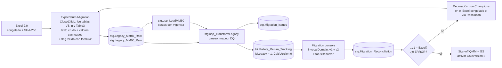

# 04 · Plan de Migración e Implementación por Fases (MVP → Producción)

> Objetivo: sustituir la MATRIZ DE RASTREO 2.0 sin perder un solo registro histórico y sin un periodo en el que nadie sepa cuál es la fuente de verdad. La duración de cada fase es una estimación para un equipo de 1 desarrollador .NET senior + 1 analista de proceso QMM a medio tiempo + el apoyo puntual de DBA/IT.

---

## 1. Hoja de ruta

```mermaid
gantt
    dateFormat  YYYY-MM-DD
    title Expo & Return FG Follow Up · Roadmap
    section Fase 0 Gobierno
    Registro SOURCE, data owner, RACI, firma de reglas      :f0, 2026-11-16, 15d
    section Fase 1 Fundaciones
    BD DEV/QAS, API + Windows Auth, Domain + pruebas golden :f1, after f0, 25d
    section Fase 2 MVP Desktop
    WPF 6 bloques, RBAC por campo, auditoría, alertas       :f2, after f1, 35d
    section Fase 3 Migración y paralelo
    Dry-runs ETL, depuración DQ con Champions              :f3a, after f1, 45d
    Piloto VS9 + corrida en paralelo                       :f3b, after f2, 15d
    section Fase 4 Go-Live
    Cutover VS1-VS9, Excel en sólo lectura, hypercare      :f4, after f3b, 20d
    section Fase 5 SAP P98
    NCo/SNC: costos MM60, HU, órdenes PPI                  :f5, after f4, 30d
    section Fase 6 Web
    Blazor sobre la misma API                              :f6, after f5, 40d
```

| Fase | Entregable | Criterio de salida (*gate*) |
|---|---|---|
| **0 · Gobierno** | Registro en **SOURCE**, data owner (ME/QMM-JuP1 Process Excellence), RACI por bloque, firma de las reglas v2 (doc 03) por QMM, GS/OSD43, MFO, LOW y HSE. Confirmación de: plazo IMMEX, tasa de duty, 9 vs 10 motivos, PPI5 vs PPI6, valuación del reflash | Acta firmada · ID de SOURCE asignado |
| **1 · Fundaciones** | BD en DEV/QAS (scripts 01–03), API con Windows Auth y SPN, `Domain` con los casos golden en verde, pipeline CI | 100 % de las pruebas golden pasan · `/health` OK en QAS |
| **2 · MVP Desktop** | WPF con 6 pestañas, lista filtrable, RBAC por campo, AuditLog, Worker de alertas, vistas `rpt.*` y un primer reporte de Power BI | UAT por rol firmado (ver §5) |
| **3 · Migración y paralelo** | ETL probado ≥ 3 veces, bitácora DQ depurada con los Champions, piloto en **VS9** (la tabla más pequeña), con 2 semanas en paralelo con el Excel | Conciliación v1 = Excel al centavo · 0 issues de severidad ERROR abiertos en VS9 |
| **4 · Go-Live** | Cutover de los 5 VS, Excel congelado en **sólo lectura**, 4 semanas de hypercare | Nadie captura en el Excel · los KPIs de Power BI salen de `rpt.*` |
| **5 · SAP P98** | `NcoSapGateway` (sólo lectura) para costo MM60, validación de HU y orden PPI | Pruebas con SNC/SSO aprobadas por SAP Basis |
| **6 · Web** | `ExpoReturn.Web` (Blazor Server) en IIS/Bosch Cloud, desktop deprecado | Paridad funcional · sin cambios en Domain/Application/BD |

## 2. Estrategia de migración del histórico (VS1, VS4, VS5, VS7, VS9)

### 2.1 Principios

1. **No se descarta nada.** Cada fila del Excel produce un registro (`IsLegacy = 1`, `LegacySourceSheet`, `LegacySourceRow`). Lo que no se puede interpretar queda en `stg.Migration_Issues` y en `DataQualityFlags`; no se "arregla en silencio".
2. **Primero igualar al Excel y después corregirlo.** Los indicadores se calculan con **CalcVersion 1** y se comparan contra los valores cacheados del Excel; sólo con esa conciliación aprobada se activa CalcVersion 2. Las diferencias v2 − v1 se presentan como **hallazgos de negocio** (p. ej. VS7: + USD 11,892.50 de exposición que no se veía).
3. **Ejecución repetible.** El ETL es idempotente por `LoadBatchId`; cada *dry-run* se hace sobre una BD restaurada desde cero.
4. **Evidencia.** Se guarda el hash SHA-256 del archivo fuente, y el conteo y la suma por hoja antes y después de cada corrida.

### 2.2 Flujo técnico



**Por qué el extractor lee tablas estructuradas y no rangos de celdas:** cada hoja empieza en otra columna (B, C o D) y tiene encabezados distintos (H-07). ClosedXML lee `VS_n` por nombre de columna, con un **diccionario de alias** por encabezado:

| Campo destino | Alias aceptados en el Excel |
|---|---|
| `Quantity` | `Quantity`, `Quantity imported` |
| `DateReturnedToWhs` | `Date PO`, `Date Returned to WHS` |
| `ReturnPO` | ` PO Number`, `Return PO` |
| `NewMaterial` | `Returned Pallet 13 Dgt New PN`, `Returned Pallet 13 Dgt New PN.` |
| `ReworkBatch` | ` Original Batch`, `Original Batch.` |
| `HseKg` | ` Qty (Kg).\n from HSE`, `Kg Qty from HSE` |
| `CommentsStatus` | `COMMENTS`, `Date - Name: `, `Column2` |
| *(ignorar)* | `.` (columna extra de VS5) |

Si una tabla trae un encabezado fuera del diccionario, la corrida se detiene: es una señal de que alguien insertó una columna.

### 2.3 Reglas de transformación (implementadas en `04_staging_migration.sql`)

| Problema heredado | Transformación | Issue registrado |
|---|---|---|
| Fechas en texto: `JAN.20.2025`, `MAR.2.2026`, `Juio/16/2026`, `17/07/2026`, seriales | `stg.fn_ParseLegacyDate` (EN/ES, tolera typos, dd/mm en textos MX) | DQ-DATE-TEXT / DQ-DATE-UNPARSEABLE |
| `Import date ELP-JuP1` = "fecha + factura" | Se separa en `ImportDateElpJup1` + `ImportInvoice` | DQ-ELP-CONCAT |
| HU con lote/fecha (`AC20887866 12/9/2025`) o sólo el lote | HU = NULL; el lote se rescata en `OriginalBatch` si venía vacío | DQ-HU-FORMAT |
| P/N sin puntos (`0203306644-250`) | `stg.fn_NormalizeMaterial` → `0203.306.644-250` | — |
| PO `49398082 - 999` | PO = `49398082`, Item = `999` | — |
| Departamento dentro del solicitante (`MFO5: Arturo…`) | `RequestingDepartmentId` = MFO5, `RequestorName` = "Arturo…" | DQ-DEPT-MISSING si no se puede inferir |
| Motivo vacío o fuera del catálogo | `ReasonId` = NULL (el Champion lo completa) | DQ-REASON-MISSING |
| `Customs Export` con fórmula/cantidad | `CustomsExportReference` = NULL | **DQ-CUSTOMS-FORMULA (ERROR)** |
| `LOW export` en texto | Se extraen `LowExportNumber` (#4) y `LowExportDate`; el texto se conserva en `LowExportNote` | — |
| HSE confirmó sin `Scrap Qty` | Se migra tal cual | **DQ-HSE-WITHOUT-QTY (ERROR)** |
| Old + Scrap ≠ Qty con MFO cerrado | Se migra tal cual (v2 lo muestra como `QtyMissing`) | **DQ-QTY-GAP (ERROR)** |
| `COSTEAR` / costo 0 | Costo de MM60 vigente o `PENDING` | DQ-COST-PENDING |
| Comentario/estatus libre | Se mapea con `stg.Map_StatusCategory` (lo puede editar QMM) | DQ-STATUS-TEXT |
| Nombres de QMM Responsible | `sec.Users` placeholder (`IsPlaceholder = 1`, `LEGACY\NOMBRE`), que después se vincula al NT ID real | — |
| `#` vacío o duplicado | Folio `900000 + fila` para revisión manual | DQ-FOLIO-DUP |

Los registros legacy quedan exentos de los `CHECK` de formato (`IsLegacy = 1`), pero **no** de las reglas de negocio de la aplicación: al editarse por primera vez después del go-live, el usuario tiene que corregir los campos con issue para poder guardar.

### 2.4 Depuración con los dueños del dato (Fase 3)

1. Por cada *dry-run* se publica un reporte Power BI "Migration DQ", con los issues por VS, área responsable y severidad.
2. Cada Champion corrige **en el Excel congelado** (copia de trabajo controlada por QMM) o registra la resolución en `stg.Migration_Issues.Resolution`.
3. Meta para el cutover: **0 ERROR**. Los WARNING se pueden migrar con bandera, siempre que el dueño del VS lo acepte.
4. **Conciliación obligatoria por VS** (acta de sign-off):

| Control | Fuente Excel | Fuente SQL | Tolerancia |
|---|---|---|---|
| Número de registros | filas con P/N o Qty en `VS_n` | `COUNT(*) WHERE LegacySourceSheet = 'VSn'` | 0 |
| Σ Quantity | columna Quantity | `SUM(QtyImported)` | 0 |
| Σ SAP USD TOTAL | valores cacheados | `SUM(SapUsdTotal)` | ± 0.01 × n |
| Σ Balance GENERAL | valores cacheados | v1 en `stg.Migration_Reconciliation` | ± 0.01 × n |
| Bloque AFTER JUNE 2025 / BALANCE_ | celdas resumen | `rpt.vw_Balance_ByVS_Period` con la ventana `LEGACY_AFTER_JUN25` | ± 1.00 USD |
| Δ v2 − v1 | — | `DeltaV2vsExcelUSD` | Explicado caso por caso y aceptado por QMM + GS |

## 3. Runbook de cutover (por VS; el piloto es VS9)

| T | Paso | Responsable |
|---|---|---|
| T-5 d | Comunicación a los Champions/Proxies: fecha de congelamiento y entrenamiento | QMM PE |
| T-2 d | Último *dry-run* completo en QAS, conciliación aprobada | Dev + QMM |
| T-0 08:00 | Excel en **sólo lectura** en SharePoint (permisos de lectura y banner "MIGRADO – usar ExpoReturn") | Dueño del sitio SharePoint |
| T-0 08:15 | Copia del archivo + SHA-256 en la carpeta de evidencia | QMM PE |
| T-0 08:30 | Respaldo FULL de la BD PRD | DBA |
| T-0 09:00 | ETL a PRD → transform → recálculo v1/v2 | Dev |
| T-0 11:00 | Conciliación PRD = QAS; firma de go/no-go | QMM + GS |
| T-0 12:00 | Habilitar los usuarios del VS en `Champions_Matrix`; arranca la captura en ExpoReturn | Admin QMM PE |
| T+1..T+20 | Hypercare: soporte en sitio en el turno 1, revisión diaria de alertas y de la bitácora | Dev + QMM |

**Rollback** (sólo dentro de las primeras 48 h): restaurar el respaldo T-0 08:30, volver a dar permisos de edición en el Excel y recapturar allí lo capturado en ExpoReturn, sacándolo de `aud.Audit_Logs` (cada cambio tiene usuario, campo y valor). Después de 48 h, se corrige hacia adelante.

## 4. Despliegue de la primera versión en JuP1

| Componente | Destino | Mecanismo |
|---|---|---|
| Base de datos | SQL Server corporativo de JuP1 (instancia con respaldo gestionado) | Scripts 01→04 + migraciones EF Core como **script idempotente** revisado por el DBA |
| API | Servidor IIS de aplicaciones de JuP1, App Pool con **gMSA**, Windows Auth, HTTPS con certificado interno | Web Deploy desde el pipeline, con aprobación manual para PRD |
| Worker | Windows Service en el mismo servidor | `sc.exe` / instalador del pipeline |
| Desktop WPF | PCs de los usuarios | Paquete **MSIX** (o el instalador que estandarice IT) publicado en **Software Center/SCCM**; autoactualizable; *self-contained* .NET 8 para no depender del runtime de la PC |
| Power BI | Workspace ME/QMM-JuP1 | On-premises Data Gateway → vistas `rpt.*` con la cuenta del rol `role_exporeturn_bi` |
| Configuración | `appsettings.{Environment}.json` sin secretos; la conexión usa Integrated Security con la gMSA | — |

Ambientes: **DEV** (desarrollador, datos sintéticos) → **QAS** (dry-runs con copia del histórico, UAT) → **PRD**.

## 5. Pruebas de aceptación de usuario (UAT) por rol

| Rol | Escenario mínimo | Esperado |
|---|---|---|
| QMM | Abrir un retorno en VS7 con P/N sin puntos y motivo reflash | Folio VS7-xxxxx, P/N normalizado, costo MM60 y SAP USD Total calculados |
| REQUESTOR (MFQ5) | Intentar editar Invoice | Campo en sólo lectura; un PUT directo a la API devuelve 403 |
| GS/OSD43 | Capturar el cruce con la factura de otro año | Advertencia VAL-023; estatus IMPORTED; LegalDueDate calculado |
| MFO | Cerrar MFO con 527/528 | Bloqueo VAL-034 → "Declarar faltante" → DUTY_RISK + alerta QTY_MISMATCH |
| LOW | Registrar expo #4 sin pedimento | Estatus PENDING_EXPORT (no se cierra) |
| GS/OSD43 | Capturar `PR26-00095` | Estatus EXPORTED; Balance 0 |
| HSE | Confirmar scrap sin GR | Bloqueo VAL-044/045 |
| Dos usuarios | Editar el mismo folio al mismo tiempo | El segundo recibe un conflicto 409 con opción de recargar |
| Admin QMM PE | Reabrir un folio cerrado | Pide motivo, queda en Audit_Logs y se recalcula el estatus |
| Viewer / Power BI | Comparar el BALANCE de VS9 con el acta de migración | Mismo total por periodo |

## 6. Gestión del cambio

* **Entrenamiento por rol** de 45 min, cada uno sólo sobre su pestaña. Guía rápida de 1 página por área.
* **Red de Champions:** el Champion de cada VS es el primer nivel de soporte; QMM PE es el segundo; el desarrollador, el tercero.
* **KPIs de adopción** (en Power BI): % de registros nuevos capturados en ExpoReturn (meta 100 % en T+5), registros con issue DQ abiertos, días promedio por etapa y alertas CRITICAL abiertas.

## 7. Riesgos y mitigaciones

| Riesgo | Prob. | Impacto | Mitigación |
|---|---|---|---|
| El histórico real tiene más variantes de formato que la muestra | Alta | Medio | 3 dry-runs, diccionario de alias, issues sin descarte, parsers con pruebas unitarias alimentadas con los valores reales |
| No se confirma a tiempo el plazo IMMEX o la tasa de duty | Media | Alto | Son parámetros con vigencia; se arranca con valores provisionales marcados [VALIDAR] y alertas conservadoras |
| La versión de NCo no soporta .NET 8 | Media | Bajo | Puerto `ISapGateway` y adaptador en .NET Framework 4.8 como servicio aparte; la Fase 1 no depende de SAP |
| Resistencia al cambio / captura doble en el Excel | Media | Alto | Excel en sólo lectura desde T-0; la vista Power BI es la única fuente oficial de BALANCE |
| Falta de SPN/Kerberos en IIS | Baja | Medio | Solicitarlo a IT en la Fase 1; usar NTLM como alternativa temporal |
| Cambios en la matriz Champions_VS | Alta | Bajo | `Champions_Matrix` con vigencia, administrada en la app por QMM PE sin intervención de TI |

## 8. Pendientes de validación del negocio (consolidado)

| # | Tema | Dueño |
|---|---|---|
| P-01 | Plazo legal real de la importación temporal del retorno (régimen y clave de pedimento) | GS/OSD43 |
| P-02 | Tasa de duty: ¿0.19 fijo o por fracción arancelaria (IGI + DTA + IVA)? | GS/OSD43 |
| P-03 | ¿Son 9 o 10 los motivos oficiales? | QMM |
| P-04 | Diferencia entre PPI5 y PPI6, y si el tipo de orden se deriva del motivo | QMM + MFO |
| P-05 | Valuación y descargo IMMEX cuando el pallet sale con otro P/N (reflash) | GS/OSD43 + Controlling |
| P-06 | Hojas BALANCE_ y Champions_VS originales (no venían en la muestra) | QMM PE |
| P-07 | Corrección de las fechas de VS1 (¿Import Date 2025 o 2026?) y del scrap no reportado de VS9 | Champions VS1 / VS9 |
| P-08 | Retención de la bitácora (≥ 5 años) | GS/OSD43 + Legal |
