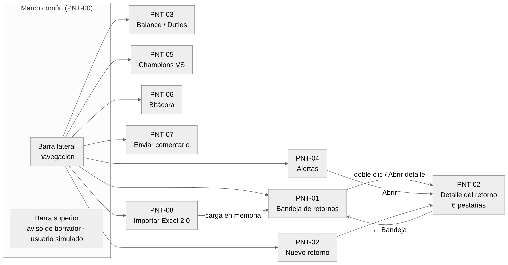

<!-- GENERADO desde entregables/UX_Manual_Pantallas_ExpoReturn_v0.1.docx el 2026-11-06 con tools/docx/docx_to_md.py. La fuente de verdad es el Word: haga los cambios en el .docx y vuelva a generar. -->

# 02 · Estructura y navegación

## Mapa de pantallas

| **ID** | **Pantalla**                                 | **Se abre desde**                                                          | **Tipo**                      |
|--------|----------------------------------------------|----------------------------------------------------------------------------|-------------------------------|
| PNT-00 | Marco común (barra lateral y barra superior) | Siempre visible                                                            | Marco                         |
| PNT-01 | Bandeja de retornos                          | Barra lateral (pantalla inicial)                                           | Lista                         |
| PNT-02 | Detalle / Nuevo retorno (6 pestañas)         | Bandeja (doble clic o *Abrir detalle*), Alertas (*Abrir*), *Nuevo retorno* | Formulario                    |
| PNT-03 | Balance / Duties                             | Barra lateral                                                              | Tablero                       |
| PNT-04 | Alertas                                      | Barra lateral                                                              | Lista de acción               |
| PNT-05 | Champions VS                                 | Barra lateral                                                              | Consulta                      |
| PNT-06 | Bitácora                                     | Barra lateral                                                              | Consulta                      |
| PNT-07 | Enviar comentario                            | Botón de la barra lateral                                                  | Diálogo                       |
| PNT-08 | Importar Excel 2.0                           | Botón de la barra lateral                                                  | Diálogo del sistema + resumen |

## Distribución común

Todas las pantallas comparten la misma estructura, para que el usuario siempre sepa dónde está:

| **Zona**                                   | **Contenido**                                                                                                                        | **Comportamiento**                                                                    |
|--------------------------------------------|--------------------------------------------------------------------------------------------------------------------------------------|---------------------------------------------------------------------------------------|
| **Barra lateral** (izquierda, azul oscuro) | Nombre de la aplicación, menú de 6 opciones, botones *Importar Excel 2.0…*, *Restaurar datos demo*, *Enviar comentario* y la versión | La opción activa se resalta con un fondo más claro y una línea azul a la izquierda    |
| **Barra superior** (blanca)                | Aviso de borrador, origen de los datos (demo o Excel importado) y selector de **usuario simulado** (nombre · rol · Value Streams)    | Al cambiar el usuario, la pantalla abierta recalcula qué campos puede editar          |
| **Área de trabajo**                        | Título de la pantalla, descripción breve y contenido                                                                                 | Encabezados de tabla en azul oscuro con texto blanco; tarjetas blancas con borde gris |

## Navegación y protección de cambios

- Si hay **cambios sin guardar** en un retorno y el usuario intenta salir (menú, *← Bandeja*, importar o restaurar), la aplicación pregunta antes de descartarlos.

- Los cambios **sólo se aplican al presionar Guardar**. *Descartar cambios* regresa a la última versión guardada.

- Después de *Restaurar datos demo* o de importar el Excel, la aplicación vuelve a la Bandeja.
