<!-- GENERADO desde entregables/UX_Manual_Pantallas_ExpoReturn_v0.1.docx el 2026-11-06 con tools/docx/docx_to_md.py. La fuente de verdad es el Word: haga los cambios en el .docx y vuelva a generar. -->

# 04 · Catálogo de pantallas

## PNT-00 · Marco común

Barra lateral y barra superior, presentes en todas las pantallas. Los números corresponden a la captura de PNT-01.

| **\#** | **Elemento**                               | **Descripción**                                                                                                                                                         |
|--------|--------------------------------------------|-------------------------------------------------------------------------------------------------------------------------------------------------------------------------|
| 1      | Menú lateral                               | Bandeja de retornos, Nuevo retorno, Balance / Duties, Alertas, Champions VS y Bitácora. La opción activa queda resaltada                                                |
| 2      | Aviso de borrador y origen de datos        | Recuerda que no hay base de datos y que los cambios se pierden al cerrar. La segunda línea dice si se ven datos demo o un Excel importado                               |
| 3      | Usuario simulado                           | Elige un usuario de prueba (nombre · rol · Value Streams). Sirve para revisar qué ve y qué edita cada área. **En producción desaparece**: el usuario será el de Windows |
| 10     | Importar Excel 2.0… / Restaurar datos demo | Carga la Matriz real en memoria (PNT-08) o vuelve a los datos de demostración                                                                                           |
| 11     | Enviar comentario                          | Abre el diálogo de retroalimentación (PNT-07) desde cualquier pantalla                                                                                                  |

**Estado UX:** verificado en la ronda 3 (v0.1.2). Contraste corregido en la ronda 1 (UX-002).

## PNT-01 · Bandeja de retornos

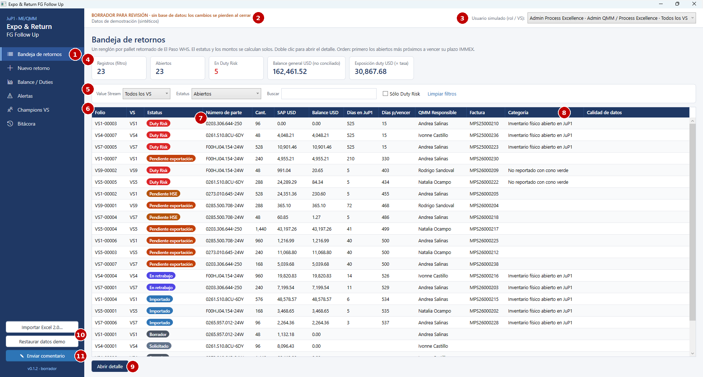

**Propósito.** Ver todos los pallets retornados y priorizar el trabajo. Sustituye a las 5 hojas VS del Excel. **Usuarios.** Todos los roles; cada uno filtra por su Value Stream.

| **\#** | **Elemento**                 | **Descripción**                                                                                                                                                           |
|--------|------------------------------|---------------------------------------------------------------------------------------------------------------------------------------------------------------------------|
| 4      | Indicadores (KPIs)           | Registros del filtro, abiertos, en Duty Risk, balance general USD no conciliado y exposición a duty (balance × tasa). Se recalculan al cambiar los filtros                |
| 5      | Filtros                      | Value Stream, Estatus (por defecto "Abiertos"), búsqueda libre (folio, número de parte, HU/lote, factura, QMM o referencia aduanal), "Sólo Duty Risk" y *Limpiar filtros* |
| 6      | Tabla de retornos            | Un renglón por pallet. **Orden por defecto: primero los abiertos más próximos a vencer el plazo IMMEX**; los cerrados al final. Clic en un encabezado para reordenar      |
| 7      | Etiqueta de estatus          | Color según el estatus calculado (capítulo 03)                                                                                                                            |
| 8      | Categoría / Calidad de datos | Categoría de estatus (antes "COMMENTS"). *Calidad de datos* sólo se llena con registros importados del Excel                                                              |
| 9      | Abrir detalle                | Abre el renglón seleccionado (equivale a doble clic)                                                                                                                      |

**Acciones.** Filtrar, buscar, reordenar, abrir un retorno. **Reglas visibles.** Días en JuP1 = desde el cruce ELP-JuP1. Días p/vencer = plazo IMMEX provisional de 540 días \[VALIDAR GS/OSD43\]. **Estado UX:** verificado en la ronda 3. Corregidos el orden por defecto (UX-009) y las columnas recortadas (UX-010). Observaciones abiertas: UX-B06 y UX-B07.

## PNT-02 · Detalle / Nuevo retorno

Formulario único para capturar y consultar un retorno. Tiene **6 pestañas, una por bloque del Excel**, y un panel derecho fijo de conciliación y validaciones. Los indicadores, el estatus y las validaciones **se recalculan mientras se escribe**, antes de guardar.

### PNT-02.1 · Pestaña 1: Solicitud (QMM)

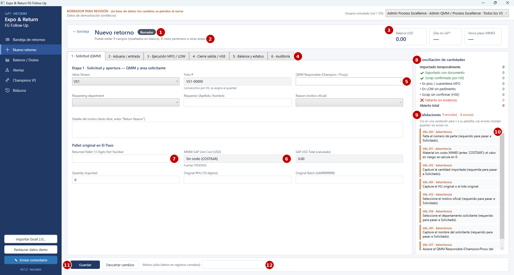

**Usuarios.** QMM (Champion/Proxy) y áreas solicitantes (MFQ, QMM-C, LOP, PUQ). Admin QMM/PE.

| **\#** | **Elemento**                | **Descripción**                                                                                                                                    |
|--------|-----------------------------|----------------------------------------------------------------------------------------------------------------------------------------------------|
| 1      | Título y estatus            | Folio (o "Nuevo retorno") y etiqueta del estatus calculado. Pueden aparecer las etiquetas "Histórico Excel (sólo lectura)" y "Cambios sin guardar" |
| 2      | Leyenda de permisos         | Cuántos campos puede editar el usuario, o por qué el registro es de sólo lectura (otra área, otro VS, registro cerrado o histórico)                |
| 3      | Indicadores del encabezado  | Balance USD, días en JuP1 y fecha de vencimiento del plazo IMMEX                                                                                   |
| 4      | Pestañas por bloque         | 1 Solicitud · 2 Aduana/entrada · 3 Ejecución MFO/LOW · 4 Cierre salida/HSE · 5 Balance y estatus · 6 Auditoría                                     |
| 5      | Campo editable              | Fondo blanco. QMM Responsible ofrece los Champions/Proxies del VS y también admite texto                                                           |
| 6      | Campos calculados           | Costo MM60 y SAP USD Total: sólo lectura. Sin costo aparece "Sin costo (COSTEAR)" y la fuente "PENDING"                                            |
| 7      | Número de parte             | Acepta capturas sin puntos (p. ej. `0265957012-24W`) y muestra en azul cómo se guardará                                                            |
| 8      | Conciliación de cantidades  | Importado, exportado con documento, scrap confirmado, en piso MFO, en LOW sin pedimento, scrap sin confirmar, faltante y abierto total             |
| 9      | Resumen de validaciones     | Número de errores (impiden guardar) y de avisos (permiten guardar)                                                                                 |
| 10     | Lista de validaciones       | Código VAL-xxx, severidad y mensaje. **Un clic lleva a la pestaña del campo**                                                                      |
| 11     | Guardar / Descartar cambios | Guardar asigna el folio (en el alta), valida, recalcula y registra la bitácora. Descartar regresa a lo último guardado                             |
| 12     | Motivo                      | Obligatorio sólo cuando Admin modifica un registro cerrado; queda en la bitácora                                                                   |

**Reglas visibles.** VAL-001, VAL-010 a VAL-017. Un borrador se puede guardar incompleto: los obligatorios aparecen como avisos y el registro no pasa a "Solicitado" hasta completarlos. **Estado UX:** verificado en la ronda 3. Observaciones abiertas: UX-B01, UX-B02, UX-B03 y UX-B04.

### PNT-02.2 · Pestaña 2: Aduana / entrada

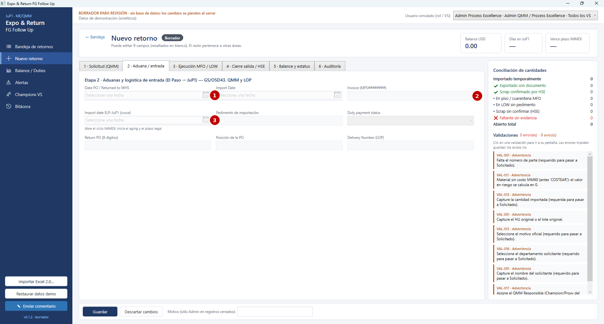

**Usuarios.** GS/OSD43 (fechas, factura, pedimento, estatus de duty), QMM (Date PO, PO de retorno) y LOP (Delivery Number).

| **\#** | **Elemento**        | **Descripción**                                                                                                    |
|--------|---------------------|--------------------------------------------------------------------------------------------------------------------|
| 1      | Fechas              | Date PO / Returned to WHS e Import Date, con selector de calendario. En gris cuando el usuario no las puede editar |
| 2      | Campos de otra área | En el alta, toda esta pestaña está bloqueada: primero se completa la Solicitud                                     |
| 3      | Cruce ELP-JuP1      | **Abre el ciclo IMMEX**: inicia el aging y el plazo legal. Requiere Import Date y factura (VAL-022)                |

**Reglas visibles.** VAL-020 a VAL-025. Por ejemplo, la factura cuyo año no coincide con Import Date genera un aviso. **Estado UX:** verificado. Las fechas deshabilitadas en gris se corrigieron en la ronda 1 (UX-007).

### PNT-02.3 · Pestaña 3: Ejecución MFO / LOW

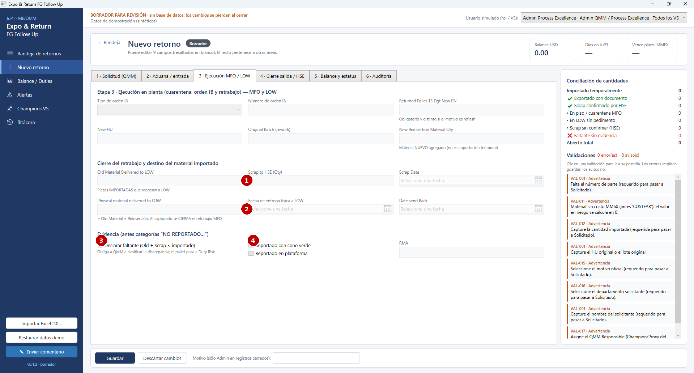

**Usuarios.** MFO del Value Stream.

| **\#** | **Elemento**                   | **Descripción**                                                                                                  |
|--------|--------------------------------|------------------------------------------------------------------------------------------------------------------|
| 1      | Destino del material importado | Old Material Delivered to LOW (piezas importadas que regresan), Scrap to HSE y Scrap Date                        |
| 2      | Cierre del retrabajo           | Physical material delivered to LOW (= Old + Reinserción) y fechas. Al capturarlo **se cierra el retrabajo MFO**  |
| 3      | Declarar faltante              | Se marca cuando Old + Scrap \< importado. Obliga a QMM a clasificar la discrepancia y el pallet pasa a Duty Risk |
| 4      | Evidencia                      | Reportado con cono verde / en plataforma (sí / no) y RMA                                                         |

**Reglas visibles.** VAL-030 a VAL-038. Por ejemplo, VAL-034: no se puede cerrar MFO con piezas sin conciliar si no se declara el faltante. **Estado UX:** verificado. Las casillas de evidencia pasaron a sí/no en la ronda 1 (UX-008).

### PNT-02.4 · Pestaña 4: Cierre salida / HSE

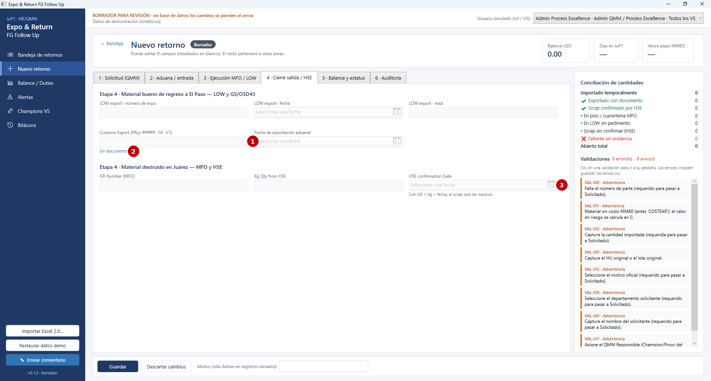

**Usuarios.** LOW (expo), GS/OSD43 (Customs Export), MFO (GR Number) y HSE (kg y fecha de confirmación).

| **\#** | **Elemento**           | **Descripción**                                                                                                                                      |
|--------|------------------------|------------------------------------------------------------------------------------------------------------------------------------------------------|
| 1      | Customs Export y fecha | Acepta `PRyy-#####` (exportación), `F4` (cambio de régimen) o `V1` (pedimento virtual). Textos como "scrap marzo" **no cierran** el pallet (VAL-046) |
| 2      | Tipo de documento      | Muestra en azul cómo se interpretó la referencia: sin documento, exportación, F4, V1 o texto no reconocido                                           |
| 3      | Confirmación HSE       | Con GR + kg + fecha, el scrap sale del balance                                                                                                       |

**Estado UX:** verificado en la ronda 3, sin observaciones.

### PNT-02.5 · Pestaña 5: Balance y estatus

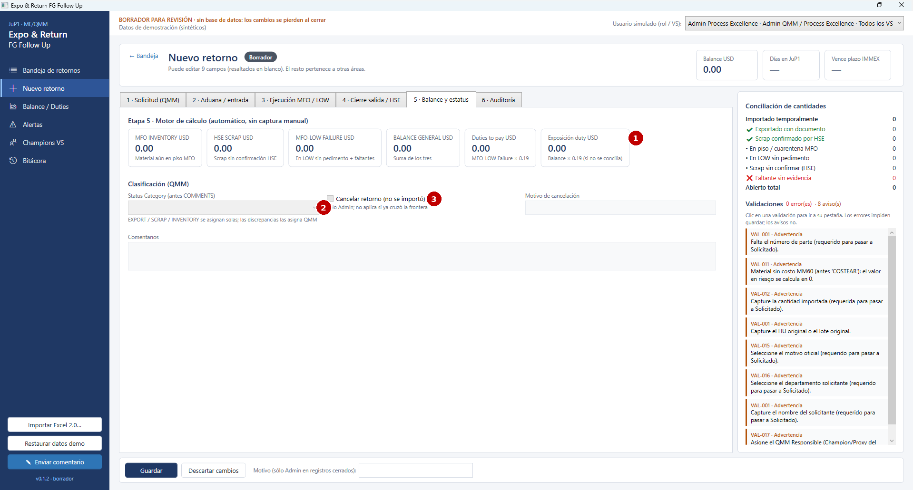

**Usuarios.** Todos consultan; QMM clasifica; Admin cancela.

| **\#** | **Elemento**           | **Descripción**                                                                                                                                   |
|--------|------------------------|---------------------------------------------------------------------------------------------------------------------------------------------------|
| 1      | Indicadores calculados | MFO Inventory, HSE Scrap, MFO-LOW Failure, Balance general, Duties to pay (Failure × 0.19) y Exposición duty (Balance × 0.19). **No se capturan** |
| 2      | Status Category        | EXPORT, SCRAP e INVENTORY se asignan solas; las categorías de discrepancia las asigna QMM, con el área responsable                                |
| 3      | Cancelar retorno       | Sólo Admin y sólo si el pallet no ha cruzado la frontera (VAL-052)                                                                                |

**Estado UX:** verificado en la ronda 3, sin observaciones.

### PNT-02.6 · Pestaña 6: Auditoría

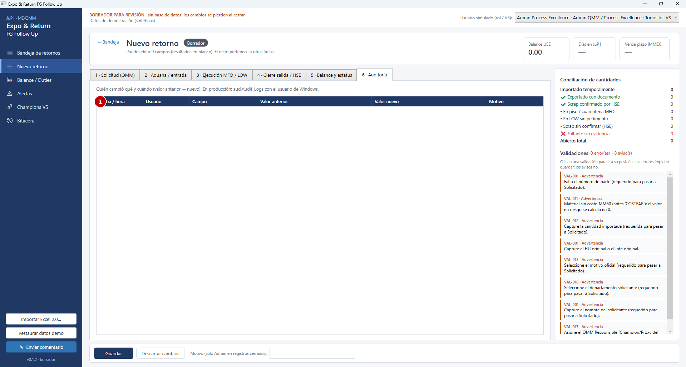

| **\#** | **Elemento**           | **Descripción**                                                                                                          |
|--------|------------------------|--------------------------------------------------------------------------------------------------------------------------|
| 1      | Historial del registro | Fecha/hora, usuario, campo, valor anterior, valor nuevo y motivo. Incluye los cambios automáticos de estatus ("SISTEMA") |

**Estado UX:** verificado. En un retorno nuevo aparece vacía hasta el primer guardado.

## PNT-03 · Balance / Duties

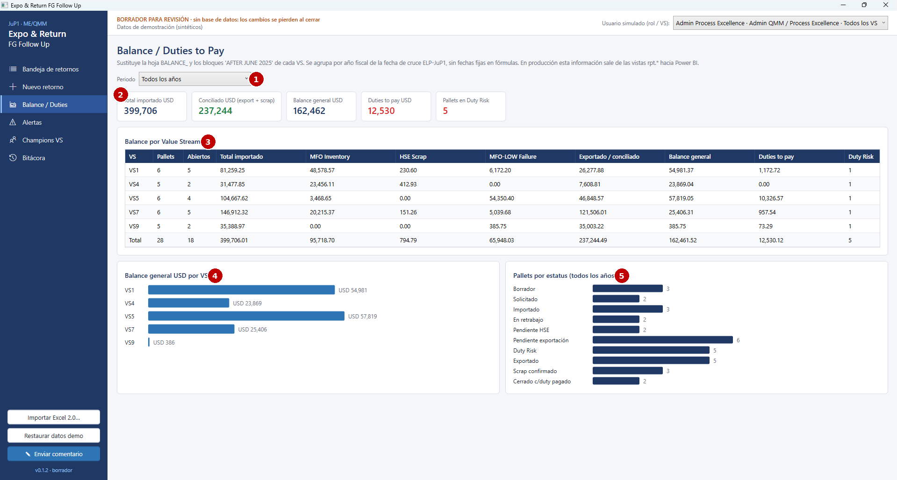

**Propósito.** Sustituye la hoja BALANCE y los bloques "AFTER JUNE 2025" de cada VS, sin fórmulas ni fechas fijas. **Usuarios.** Jefaturas, QMM, GS/OSD43 y Process Excellence.

| **\#** | **Elemento**             | **Descripción**                                                                                        |
|--------|--------------------------|--------------------------------------------------------------------------------------------------------|
| 1      | Periodo                  | Todos los años o un año fiscal (por fecha de cruce ELP-JuP1)                                           |
| 2      | Indicadores              | Total importado, conciliado (exportado + scrap), balance general, Duties to pay y pallets en Duty Risk |
| 3      | Balance por Value Stream | Una fila por VS y el total, con los cuatro indicadores financieros                                     |
| 4      | Barras por VS            | Comparación visual del balance general USD                                                             |
| 5      | Pallets por estatus      | Distribución de todos los registros por estatus                                                        |

**Estado UX:** verificado en la ronda 3. Observación abierta: UX-B13.

## PNT-04 · Alertas

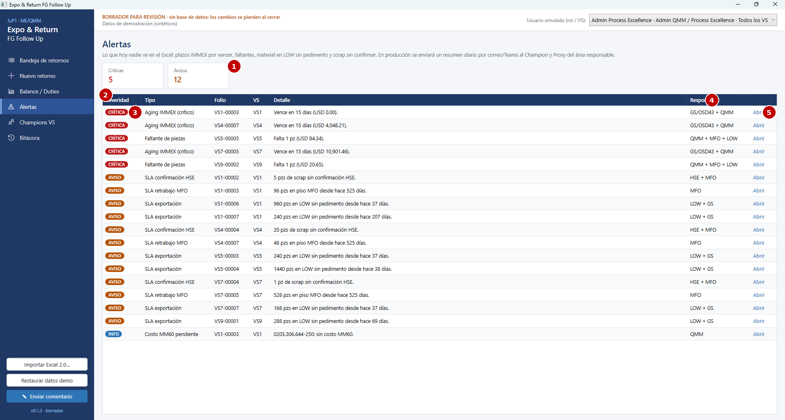

**Propósito.** Lista de acción: lo que hoy nadie ve en el Excel. **Usuarios.** Todos; cada área atiende las alertas de las que es responsable.

| **\#** | **Elemento**     | **Descripción**                                                                                                             |
|--------|------------------|-----------------------------------------------------------------------------------------------------------------------------|
| 1      | Contadores       | Número de alertas críticas y de avisos                                                                                      |
| 2      | Tabla de alertas | Tipo, folio, VS, detalle y responsable. Las críticas aparecen primero                                                       |
| 3      | Severidad        | CRÍTICA: plazo IMMEX por vencer o vencido, faltante. AVISO: SLA de retrabajo, exportación o HSE. INFO: costo MM60 pendiente |
| 4      | Responsable      | Área que debe actuar. En producción recibirá el resumen diario por correo o Teams                                           |
| 5      | Abrir            | Abre el retorno en el detalle (PNT-02)                                                                                      |

**Estado UX:** verificado. Redacción en singular corregida en la ronda 2 (UX-011). Observación abierta: UX-B09.

## PNT-05 · Champions VS

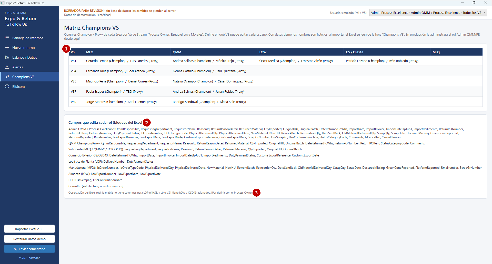

| **\#** | **Elemento**               | **Descripción**                                                                                                                                               |
|--------|----------------------------|---------------------------------------------------------------------------------------------------------------------------------------------------------------|
| 1      | Matriz Champions / Proxies | Por VS y área. Define en qué VS puede editar cada usuario. En el borrador los nombres son ficticios; con el Excel importado se leen de la hoja "Champions VS" |
| 2      | Campos por rol             | Qué campos edita cada rol (bloques del Excel). Consulta: sólo lectura                                                                                         |
| 3      | Observación del Excel real | Faltan columnas para LOP y HSE, y sólo VS1 tiene LOW y OSD43 asignados \[por definir con el Process Owner\]                                                   |

**Estado UX:** verificado (UX-012 corregido). Observación abierta: UX-B10.

## PNT-06 · Bitácora

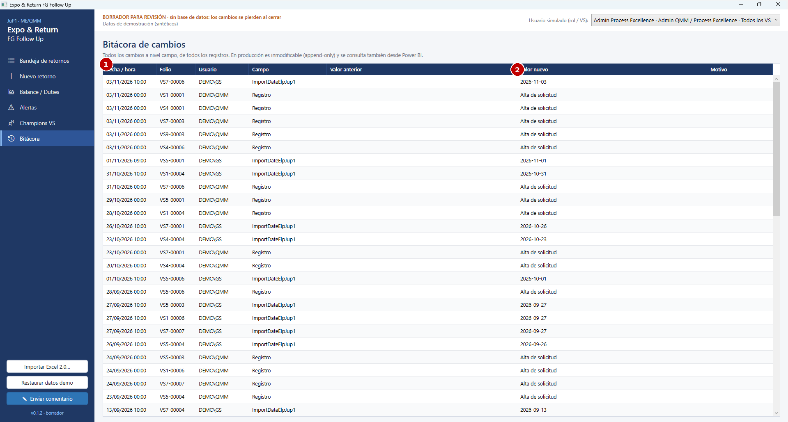

| **\#** | **Elemento**           | **Descripción**                                                                 |
|--------|------------------------|---------------------------------------------------------------------------------|
| 1      | Tabla de cambios       | Todos los cambios de todos los registros, del más reciente al más antiguo       |
| 2      | Valor anterior → nuevo | Permite reconstruir quién cambió qué y cuándo. En producción será inmodificable |

**Estado UX:** verificado. Observación abierta: UX-B08.

## PNT-07 · Enviar comentario

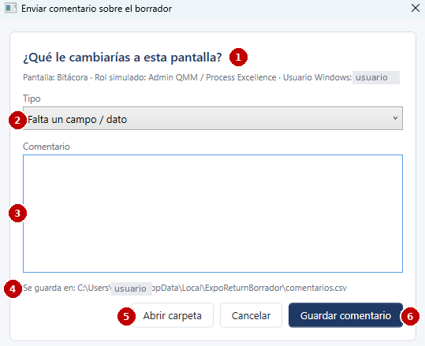

**Propósito.** Que cada revisor del borrador deje su opinión sin salir de la aplicación. *(En la captura se ocultó el usuario de Windows.)*

| **\#** | **Elemento**          | **Descripción**                                                                                                    |
|--------|-----------------------|--------------------------------------------------------------------------------------------------------------------|
| 1      | Contexto              | Pantalla desde la que se abrió, rol simulado y usuario de Windows, que se registran solos                          |
| 2      | Tipo                  | Falta un campo · Sobra un campo · Regla o cálculo incorrecto · Difícil de usar · Permisos · Idea de mejora · Error |
| 3      | Comentario            | Texto libre                                                                                                        |
| 4      | Ubicación del archivo | `%LOCALAPPDATA%\ExpoReturnBorrador\comentarios.csv` (un renglón por comentario)                                    |
| 5      | Abrir carpeta         | Abre la carpeta para enviar el CSV a QMM / Process Excellence                                                      |
| 6      | Guardar comentario    | Agrega el comentario al CSV y confirma                                                                             |

**Estado UX:** verificado. El botón recortado se corrigió en la ronda 1 (UX-006).

## PNT-08 · Importar Excel 2.0

Sin captura (usa el diálogo estándar de Windows para abrir archivos).

| **Paso** | **Qué ve el usuario**                                                                                                                                                                           |
|----------|-------------------------------------------------------------------------------------------------------------------------------------------------------------------------------------------------|
| 1        | Clic en *Importar Excel 2.0…* (barra lateral). Si hay cambios sin guardar, se pide confirmación                                                                                                 |
| 2        | Diálogo de Windows para elegir la MATRIZ DE RASTREO 2.0 (.xlsx). Si el archivo está abierto en Excel, se pide cerrarlo                                                                          |
| 3        | Mensaje de resumen: registros por VS, número de observaciones de calidad de datos y las 8 más frecuentes                                                                                        |
| 4        | La Bandeja muestra los registros históricos con la etiqueta "Histórico Excel (sólo lectura)" en el detalle y la columna *Calidad de datos* llena. La barra superior indica el archivo importado |

**Reglas visibles.** Los históricos no se editan y **nada se escribe en el Excel**. El estatus se recalcula con las reglas nuevas. **Estado UX:** pendiente de revisión con usuarios. No se ha probado en las rondas 1 a 3.
