<!-- GENERADO desde entregables/UX_Manual_Pantallas_ExpoReturn_v0.3.docx el 2026-11-06 con tools/docx/docx_to_md.py. La fuente de verdad es el Word: haga los cambios en el .docx y vuelva a generar. -->

# 04 · Catálogo de pantallas

## PNT-00 · Marco común

Barra lateral y barra superior, presentes en todas las pantallas. Los números corresponden a la captura de PNT-01.

| **\#** | **Elemento**                               | **Descripción**                                                                                                                                                                                                                                               |
|--------|--------------------------------------------|---------------------------------------------------------------------------------------------------------------------------------------------------------------------------------------------------------------------------------------------------------------|
| 1      | Menú lateral                               | Bandeja de retornos, Nuevo retorno, Balance / Aranceles, Alertas, Champions VS y Bitácora. La opción activa queda resaltada                                                                                                                                   |
| 2      | Aviso de borrador y origen de datos        | Recuerda que no hay base de datos y que los cambios se pierden al cerrar. La segunda línea dice si se ven datos demo o un Excel importado                                                                                                                     |
| 3      | Usuario simulado                           | Lista de usuarios de prueba **agrupada por área** (nombre · área · VS). Sale de la matriz Champions VS: cada persona edita sólo en los VS donde está asignada. Admin y Consulta ven todos los VS. **En producción desaparece**: el usuario será el de Windows |
| 10     | Importar Excel 2.0… / Restaurar datos demo | Carga la Matriz real en memoria (PNT-08) o vuelve a los datos de demostración                                                                                                                                                                                 |
| 11     | Enviar comentario                          | Abre el diálogo de retroalimentación (PNT-07) desde cualquier pantalla                                                                                                                                                                                        |

Atajos de teclado: Ctrl+N nuevo retorno (cualquier pantalla); Ctrl+F buscar, Enter abrir y Ctrl+E exportar (Bandeja); Ctrl+S guardar, Ctrl+1 a Ctrl+6 pestañas y Esc regresar (Detalle).

**Estado UX:** verificado en la ronda 4 (v0.1.5).

## PNT-01 · Bandeja de retornos

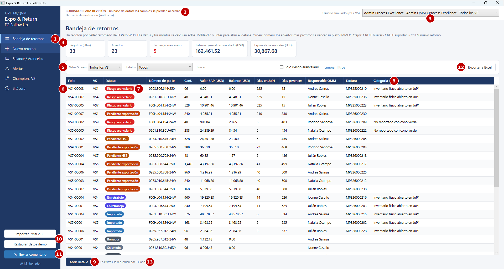

**Propósito.** Ver todos los pallets retornados y priorizar el trabajo. Sustituye a las 5 hojas VS del Excel. **Usuarios.** Todos los roles; cada uno filtra por su Value Stream.

| **\#** | **Elemento**        | **Descripción**                                                                                                                                                                                          |
|--------|---------------------|----------------------------------------------------------------------------------------------------------------------------------------------------------------------------------------------------------|
| 4      | Indicadores (KPIs)  | Registros del filtro, abiertos, en riesgo arancelario, balance general USD no conciliado y exposición a aranceles (balance × tasa). Se recalculan al cambiar los filtros                                 |
| 5      | Filtros             | Value Stream, Estatus, búsqueda libre (folio, número de parte, HU/lote, factura, QMM o referencia aduanal), "Sólo riesgo arancelario" y *Limpiar filtros*                                                |
| 6      | Tabla de retornos   | Un renglón por pallet. **Orden por defecto: primero los abiertos más próximos a vencer el plazo IMMEX**; los cerrados al final. Clic en un encabezado para reordenar; doble clic o Enter abre el detalle |
| 7      | Etiqueta de estatus | Color según el estatus calculado (capítulo 03)                                                                                                                                                           |
| 8      | Categoría           | Categoría de estatus (antes "COMMENTS"). La columna *Calidad de datos* sólo aparece cuando hay registros importados del Excel                                                                            |
| 9      | Abrir detalle       | Abre el renglón seleccionado (equivale a doble clic)                                                                                                                                                     |
| 12     | Exportar a Excel    | Exporta la vista filtrada a un Excel protegido de sólo lectura (Ctrl+E)                                                                                                                                  |
| 13     | Filtros recordados  | Los filtros se guardan por usuario y se recuperan al volver a abrir la aplicación                                                                                                                        |

**Reglas visibles.** Días en JuP1 = desde el cruce ELP-JuP1. Días p/vencer = plazo IMMEX provisional de 540 días \[VALIDAR GS/OSD43\]. **Estado UX:** verificado en la ronda 4. UX-B06, UX-B07 y UX-B12 verificados.

## PNT-02 · Detalle / Nuevo retorno

Formulario único para capturar y consultar un retorno. Tiene **6 pestañas, una por bloque del Excel**, y un panel derecho fijo de conciliación y validaciones. Los indicadores, el estatus y las validaciones **se recalculan mientras se escribe**, antes de guardar.

**Resaltado de permisos.** Los campos que el usuario actual **puede editar se muestran en verde ligero**; los que pertenecen a otra área, a otro VS o a un registro cerrado quedan en **gris**. La leyenda bajo el título repite los dos colores. Las etiquetas están en español; al pasar el cursor sobre un campo aparece su nombre en el Excel 2.0, la regla y un ejemplo.

Las capturas muestran un **alta con el usuario Admin**: en el alta sólo se captura la Solicitud (9 campos); las pestañas 2 a 5 se habilitan después de guardar, según el rol y el VS de cada usuario.

### PNT-02.1 · Pestaña 1: Solicitud (QMM)

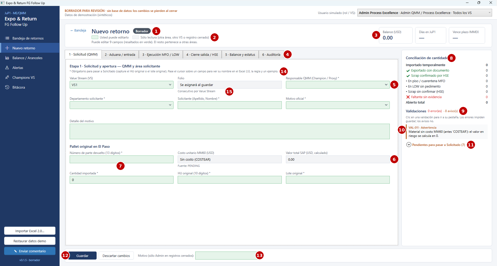

**Usuarios.** QMM (Champion/Proxy) y áreas solicitantes (MFQ, QMM-C, LOP, PUQ). Admin QMM/PE.

| **\#** | **Elemento**                       | **Descripción**                                                                                                                        |
|--------|------------------------------------|----------------------------------------------------------------------------------------------------------------------------------------|
| 1      | Título y estatus                   | Folio (o "Nuevo retorno") y etiqueta del estatus calculado. Pueden aparecer "Histórico Excel (sólo lectura)" y "Cambios sin guardar"   |
| 2      | Leyenda de permisos                | Verde = el usuario puede editarlo; gris = sólo lectura. Debajo, cuántos campos puede editar o por qué el registro es de sólo lectura   |
| 3      | Indicadores del encabezado         | Balance USD, días en JuP1 y fecha de vencimiento del plazo IMMEX                                                                       |
| 4      | Pestañas por bloque                | 1 Solicitud · 2 Aduana/entrada · 3 Ejecución MFO/LOW · 4 Cierre salida/HSE · 5 Balance y estatus · 6 Auditoría (Ctrl+1 a Ctrl+6)       |
| 5      | Campo editable (verde)             | Responsable QMM ofrece los Champions/Proxies del VS según la matriz y también admite texto                                             |
| 6      | Campos calculados (gris)           | Costo unitario MM60 y Valor total SAP: sólo lectura. Sin costo aparece "Sin costo (COSTEAR)" y la fuente "PENDING"                     |
| 7      | Número de parte                    | Acepta capturas sin puntos (p. ej. `0265957012-24W`) y muestra cómo se guardará                                                        |
| 8      | Conciliación de cantidades         | Importado, exportado con documento, scrap confirmado, en piso MFO, en LOW sin pedimento, scrap sin confirmar, faltante y abierto total |
| 9      | Resumen de validaciones            | Número de errores (impiden guardar) y de avisos (permiten guardar)                                                                     |
| 10     | Lista de validaciones              | Código VAL-xxx, severidad y mensaje. **Un clic lleva a la pestaña del campo**                                                          |
| 11     | Pendientes para pasar a Solicitado | Los avisos de datos obligatorios se agrupan en una sección plegable con su número (ver PNT-02.1b)                                      |
| 12     | Guardar / Descartar cambios        | Guardar (Ctrl+S) asigna el folio en el alta, valida, recalcula y registra la bitácora. Descartar regresa a lo último guardado          |
| 13     | Motivo                             | Obligatorio sólo cuando Admin modifica un registro cerrado; queda en la bitácora                                                       |
| 14     | Leyenda de obligatorios            | El asterisco (\*) marca los datos obligatorios para pasar a Solicitado (HU original o lote original)                                   |
| 15     | Folio                              | En el alta dice "Se asignará al guardar"; es consecutivo por Value Stream                                                              |

**Reglas visibles.** VAL-001, VAL-010 a VAL-017. Un borrador se puede guardar incompleto: los obligatorios aparecen como avisos y el registro no pasa a "Solicitado" hasta completarlos. **Estado UX:** verificado en la ronda 4. UX-B01 a UX-B04 y UX-B12 verificados; UX-B05 (ayuda al pasar el cursor) por confirmar en sesión con usuarios.

### PNT-02.1b · Pendientes desplegados

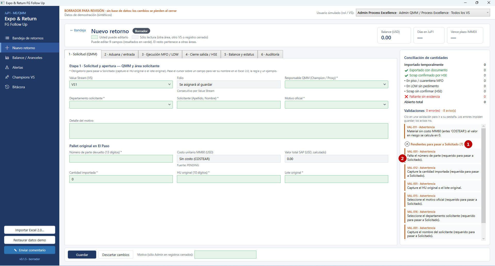

| **\#** | **Elemento**        | **Descripción**                                                                                                                               |
|--------|---------------------|-----------------------------------------------------------------------------------------------------------------------------------------------|
| 1      | Encabezado plegable | "Pendientes para pasar a Solicitado (n)". Se abre y se cierra con un clic                                                                     |
| 2      | Lista de pendientes | Un aviso por dato faltante (número de parte, cantidad, HU o lote, motivo, departamento, solicitante, responsable QMM). Un clic lleva al campo |

### PNT-02.2 · Pestaña 2: Aduana / entrada

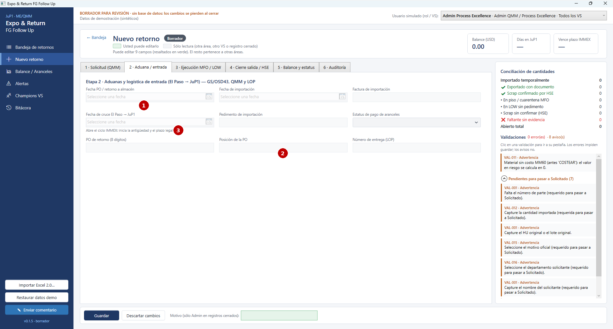

**Usuarios.** GS/OSD43 (fechas, factura, pedimento, estatus de pago de aranceles), QMM (fecha PO, PO de retorno) y LOP (número de entrega), cada uno sólo en sus VS.

| **\#** | **Elemento**                 | **Descripción**                                                                                                                |
|--------|------------------------------|--------------------------------------------------------------------------------------------------------------------------------|
| 1      | Fechas                       | Fecha PO / retorno a almacén y fecha de importación, con selector de calendario. En gris cuando el usuario no las puede editar |
| 2      | Pestaña bloqueada en el alta | En un retorno nuevo toda la pestaña está en gris: primero se completa y se guarda la Solicitud                                 |
| 3      | Cruce El Paso → JuP1         | **Abre el ciclo IMMEX**: inicia la antigüedad y el plazo legal. Requiere fecha de importación y factura (VAL-022)              |

**Reglas visibles.** VAL-020 a VAL-025. Por ejemplo, una factura cuyo año no coincide con la fecha de importación genera un aviso. **Estado UX:** verificado en la ronda 4.

### PNT-02.3 · Pestaña 3: Ejecución MFO / LOW

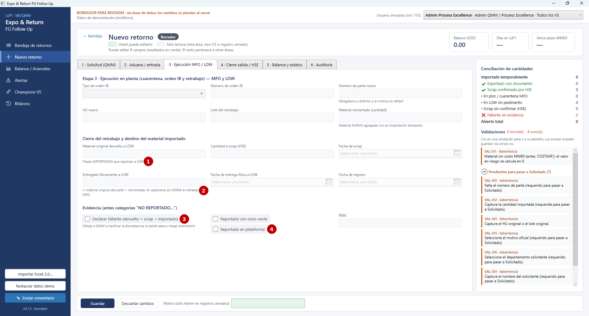

**Usuarios.** MFO del Value Stream.

| **\#** | **Elemento**                   | **Descripción**                                                                                                                 |
|--------|--------------------------------|---------------------------------------------------------------------------------------------------------------------------------|
| 1      | Destino del material importado | Material original devuelto a LOW (piezas importadas que regresan), cantidad a scrap (HSE) y fecha de scrap                      |
| 2      | Cierre del retrabajo           | Entregado físicamente a LOW (= material original devuelto + reinsertado) y fechas. Al capturarlo **se cierra el retrabajo MFO** |
| 3      | Declarar faltante              | Se marca cuando devuelto + scrap \< importado. Obliga a QMM a clasificar la discrepancia y el pallet pasa a Riesgo arancelario  |
| 4      | Evidencia                      | Reportado con cono verde / en plataforma (sí / no) y RMA                                                                        |

**Reglas visibles.** VAL-030 a VAL-038. Por ejemplo, VAL-034: no se puede cerrar MFO con piezas sin conciliar si no se declara el faltante. **Estado UX:** verificado en la ronda 4.

### PNT-02.4 · Pestaña 4: Cierre salida / HSE

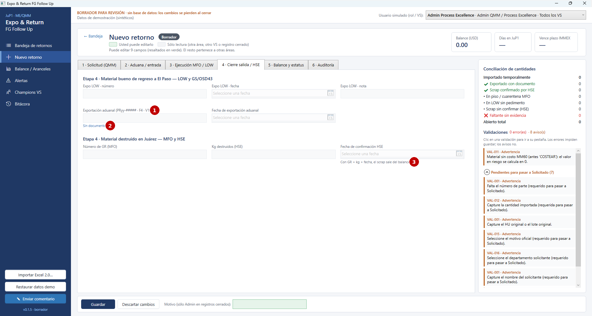

**Usuarios.** LOW (expo), GS/OSD43 (exportación aduanal), MFO (número de GR) y HSE (kg y fecha de confirmación).

| **\#** | **Elemento**                | **Descripción**                                                                                                                                      |
|--------|-----------------------------|------------------------------------------------------------------------------------------------------------------------------------------------------|
| 1      | Exportación aduanal y fecha | Acepta `PRyy-#####` (exportación), `F4` (cambio de régimen) o `V1` (pedimento virtual). Textos como "scrap marzo" **no cierran** el pallet (VAL-046) |
| 2      | Tipo de documento           | Indica cómo se interpretó la referencia: sin documento, exportación, F4, V1 o texto no reconocido                                                    |
| 3      | Confirmación HSE            | Con GR + kg + fecha, el scrap sale del balance                                                                                                       |

**Estado UX:** verificado en la ronda 4, sin observaciones.

### PNT-02.5 · Pestaña 5: Balance y estatus

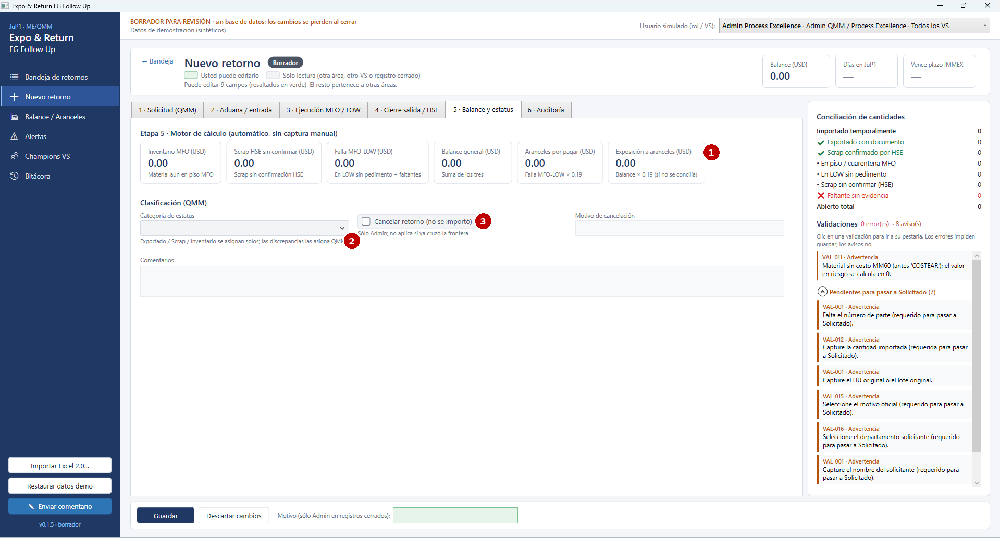

**Usuarios.** Todos consultan; QMM clasifica; Admin cancela.

| **\#** | **Elemento**           | **Descripción**                                                                                                                                                           |
|--------|------------------------|---------------------------------------------------------------------------------------------------------------------------------------------------------------------------|
| 1      | Indicadores calculados | Inventario MFO, scrap HSE sin confirmar, falla MFO-LOW, balance general, aranceles por pagar (falla × 0.19) y exposición a aranceles (balance × 0.19). **No se capturan** |
| 2      | Categoría de estatus   | Exportado, Scrap e Inventario se asignan solas; las categorías de discrepancia las asigna QMM, con el área responsable                                                    |
| 3      | Cancelar retorno       | Sólo Admin y sólo si el pallet no ha cruzado la frontera (VAL-052)                                                                                                        |

**Estado UX:** verificado en la ronda 4, sin observaciones.

### PNT-02.6 · Pestaña 6: Auditoría

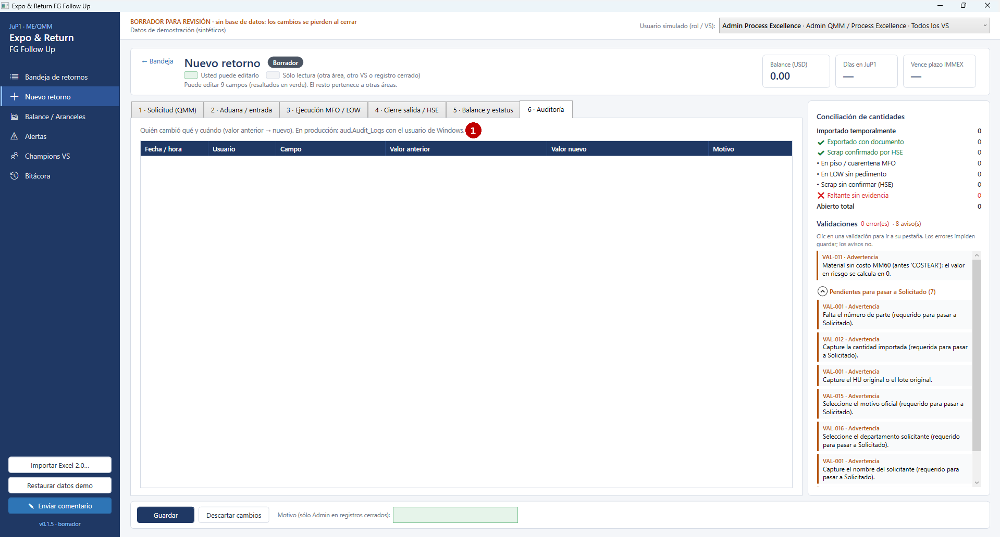

| **\#** | **Elemento**           | **Descripción**                                                                                                                                                                      |
|--------|------------------------|--------------------------------------------------------------------------------------------------------------------------------------------------------------------------------------|
| 1      | Historial del registro | Fecha/hora, usuario, campo, valor anterior, valor nuevo y motivo. Incluye los cambios automáticos de estatus ("SISTEMA"). En un retorno nuevo aparece vacía hasta el primer guardado |

**Estado UX:** verificado en la ronda 4.

## PNT-03 · Balance / Aranceles

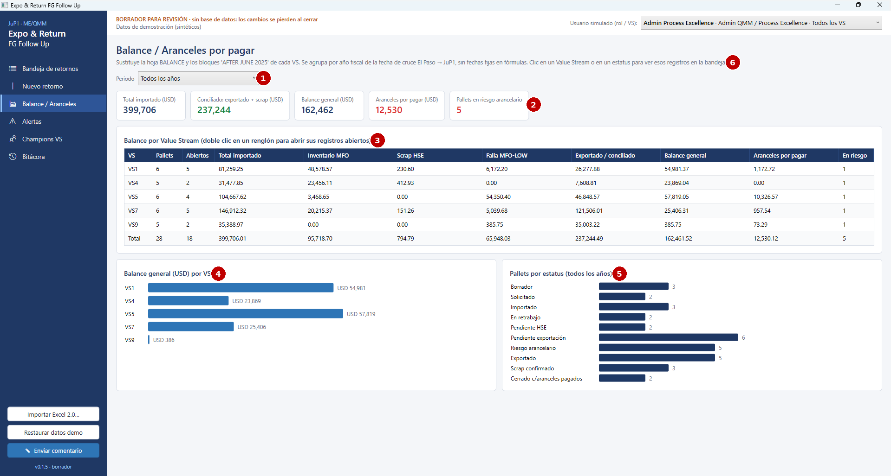

**Propósito.** Sustituye la hoja BALANCE y los bloques "AFTER JUNE 2025" de cada VS, sin fórmulas ni fechas fijas. **Usuarios.** Jefaturas, QMM, GS/OSD43 y Process Excellence.

| **\#** | **Elemento**             | **Descripción**                                                                                                       |
|--------|--------------------------|-----------------------------------------------------------------------------------------------------------------------|
| 1      | Periodo                  | Todos los años o un año fiscal (por fecha de cruce El Paso → JuP1)                                                    |
| 2      | Indicadores              | Total importado, conciliado (exportado + scrap), balance general, aranceles por pagar y pallets en riesgo arancelario |
| 3      | Balance por Value Stream | Una fila por VS y el total. Doble clic en un renglón abre sus registros abiertos en la Bandeja                        |
| 4      | Barras por VS            | Comparación visual del balance general USD                                                                            |
| 5      | Pallets por estatus      | Distribución de todos los registros por estatus                                                                       |
| 6      | Navegación a la Bandeja  | Clic en un VS o en un estatus abre la Bandeja filtrada                                                                |

**Estado UX:** verificado en la ronda 4. UX-B13: la indicación está en pantalla; la navegación se confirma en sesión con usuarios.

## PNT-04 · Alertas

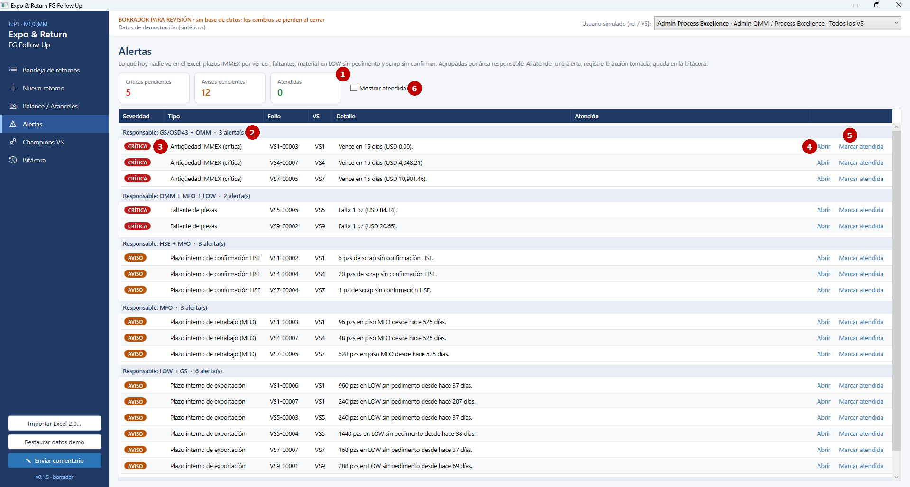

**Propósito.** Lista de acción: lo que hoy nadie ve en el Excel. **Usuarios.** Todos; cada área atiende las alertas de las que es responsable.

| **\#** | **Elemento**          | **Descripción**                                                                                                                         |
|--------|-----------------------|-----------------------------------------------------------------------------------------------------------------------------------------|
| 1      | Contadores            | Críticas pendientes, avisos pendientes y atendidas                                                                                      |
| 2      | Grupo por responsable | Las alertas se agrupan por área responsable, con el número de alertas de cada grupo                                                     |
| 3      | Severidad             | CRÍTICA: plazo IMMEX por vencer o vencido, faltante. AVISO: plazos internos de retrabajo, exportación o HSE. INFO: costo MM60 pendiente |
| 4      | Abrir                 | Abre el retorno en el detalle (PNT-02)                                                                                                  |
| 5      | Marcar atendida       | Pide un comentario con la acción tomada; queda en la bitácora                                                                           |
| 6      | Mostrar atendidas     | Muestra también las alertas ya atendidas                                                                                                |

**Estado UX:** verificado en la ronda 4. UX-B09 verificado.

## PNT-05 · Champions VS

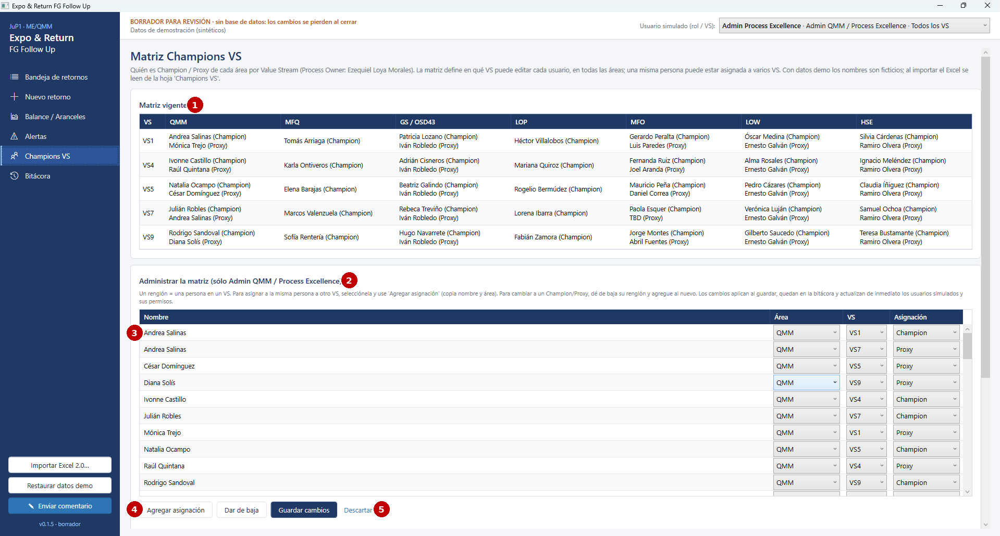

**Propósito.** Definir quién es Champion / Proxy de cada área en cada Value Stream. **La matriz delimita en qué VS edita cada usuario, en todas las áreas** (QMM, MFQ, GS/OSD43, LOP, MFO, LOW y HSE). Una persona puede estar asignada a varios VS.

| **\#** | **Elemento**                     | **Descripción**                                                                                                                                                        |
|--------|----------------------------------|------------------------------------------------------------------------------------------------------------------------------------------------------------------------|
| 1      | Matriz vigente                   | Champions y Proxies por VS y área. En el borrador los nombres son ficticios (al menos uno por área y por VS); con el Excel importado se leen de la hoja "Champions VS" |
| 2      | Administrar la matriz            | Sólo Admin QMM / Process Excellence. Para los demás roles es de sólo lectura                                                                                           |
| 3      | Renglones de asignación          | Un renglón = una persona en un VS: nombre, área, VS y asignación (Champion / Proxy). Sin fechas de vigencia                                                            |
| 4      | Agregar asignación / Dar de baja | Agregar copia la persona y el área seleccionadas para asignarla a otro VS. Dar de baja quita la asignación al guardar                                                  |
| 5      | Guardar cambios / Descartar      | Al guardar, cada alta y baja queda en la bitácora y se actualizan de inmediato los usuarios simulados, sus VS y la lista de Responsable QMM                            |

Más abajo, la pantalla muestra **qué campos edita cada rol** y la observación del Excel real (sin columnas para LOP ni HSE; sólo VS1 tiene LOW y OSD43) \[por definir con el Process Owner\].

**Estado UX:** verificado en la ronda 4. UX-B10, UX-B14 y UX-B15 verificados.

## PNT-06 · Bitácora

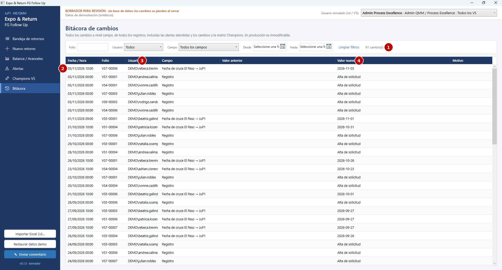

| **\#** | **Elemento**           | **Descripción**                                                                                                                                |
|--------|------------------------|------------------------------------------------------------------------------------------------------------------------------------------------|
| 1      | Filtros                | Folio, usuario, campo y rango de fechas; *Limpiar filtros* y número de cambios visibles                                                        |
| 2      | Tabla de cambios       | Todos los cambios de todos los registros, del más reciente al más antiguo, incluidas las alertas atendidas y los cambios a la matriz Champions |
| 3      | Usuario                | Usuario de red que hizo el cambio (en el borrador, `DEMO\nombre.apellido`)                                                                     |
| 4      | Valor anterior → nuevo | Permite reconstruir quién cambió qué y cuándo. En producción será inmodificable                                                                |

**Estado UX:** verificado en la ronda 4. UX-B08 verificado. Hallazgos abiertos: UX-013 y UX-014.

## PNT-07 · Enviar comentario

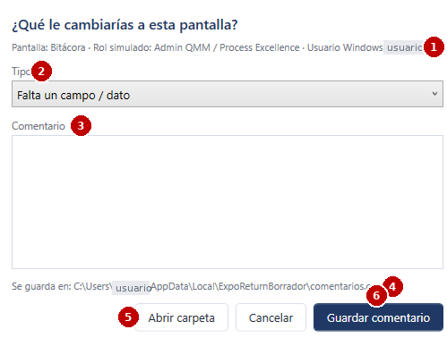

**Propósito.** Que cada revisor del borrador deje su opinión sin salir de la aplicación. *(En la captura se ocultó el usuario de Windows.)*

| **\#** | **Elemento**          | **Descripción**                                                                                                    |
|--------|-----------------------|--------------------------------------------------------------------------------------------------------------------|
| 1      | Contexto              | Pantalla desde la que se abrió, rol simulado y usuario de Windows, que se registran solos                          |
| 2      | Tipo                  | Falta un campo · Sobra un campo · Regla o cálculo incorrecto · Difícil de usar · Permisos · Idea de mejora · Error |
| 3      | Comentario            | Texto libre                                                                                                        |
| 4      | Ubicación del archivo | `%LOCALAPPDATA%\ExpoReturnBorrador\comentarios.csv` (un renglón por comentario)                                    |
| 5      | Abrir carpeta         | Abre la carpeta para enviar el CSV a QMM / Process Excellence                                                      |
| 6      | Guardar comentario    | Agrega el comentario al CSV y confirma                                                                             |

**Estado UX:** verificado en la ronda 4.

## PNT-08 · Importar Excel 2.0

Sin captura (usa el diálogo estándar de Windows para abrir archivos).

| **Paso** | **Qué ve el usuario**                                                                                                                                                                                                                                                      |
|----------|----------------------------------------------------------------------------------------------------------------------------------------------------------------------------------------------------------------------------------------------------------------------------|
| 1        | Clic en *Importar Excel 2.0…* (barra lateral). Si hay cambios sin guardar, se pide confirmación                                                                                                                                                                            |
| 2        | Diálogo de Windows para elegir la MATRIZ DE RASTREO 2.0 (.xlsx). Si el archivo está abierto en Excel, se pide cerrarlo                                                                                                                                                     |
| 3        | Mensaje de resumen: registros por VS, número de observaciones de calidad de datos y las 8 más frecuentes                                                                                                                                                                   |
| 4        | La Bandeja muestra los registros históricos con la etiqueta "Histórico Excel (sólo lectura)" en el detalle y la columna *Calidad de datos*. La matriz Champions se reemplaza por la hoja "Champions VS"; las áreas sin asignación no editan hasta que el Admin las agregue |

**Reglas visibles.** Los históricos no se editan y **nada se escribe en el Excel**. El estatus se recalcula con las reglas nuevas. **Estado UX:** pendiente de revisión con usuarios. No se ha probado en las rondas 1 a 4.
